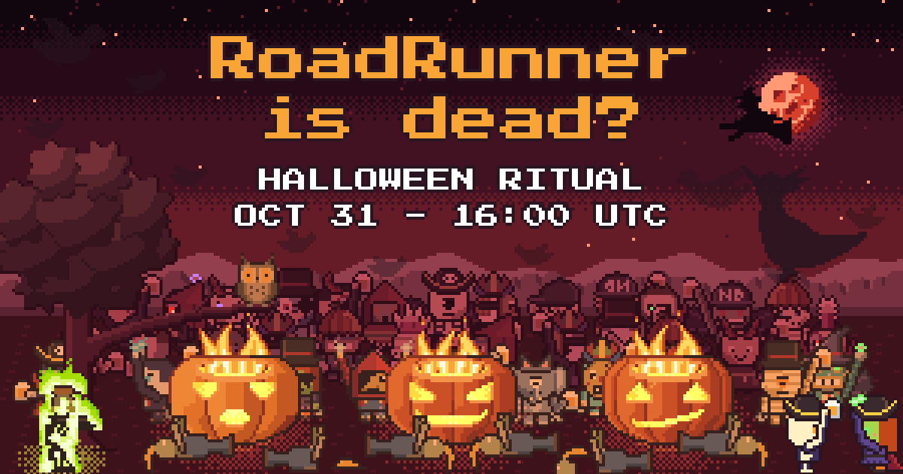

# Hellowin



Демо вебсокетов и каналов на Spiral Framework, RoadRunner 3 и Centrifugo. Контекст для агентов — [`AGENTS.md`](AGENTS.md), спецификации — в
[`docs/spec/`](docs/spec/).

## Запуск

Всё поднимается через Docker Compose. Страницы и статику отдаёт сам RoadRunner, без nginx; Centrifugo и Grafana
опубликованы своими портами:

| URL | Что |
|---|---|
| `http://localhost:8080/` | страница Hellowin (RoadRunner) |
| `ws://localhost:8000/connection/websocket` | WebSocket Centrifugo |
| `http://localhost:3000/` | дашборд «Hellowin» (публичный, только чтение) |

1. Для локального запуска настраивать ничего не нужно. Переменные Compose (см. ниже) берутся из `.env`, пример —
   `.env.docker.example`. Режим приложения в контейнере от `.env` не зависит: `docker-compose.yml` всегда задаёт
   `APP_ENV=prod`, `DEBUG=false`.

2. Запустите:

   ```bash
   docker compose up -d --build
   docker compose ps          # все сервисы должны стать healthy
   ```

3. Откройте `http://localhost:8080/` и `http://localhost:3000/`.

Остановить: `docker compose down`. Данные Valkey, Prometheus и Grafana остаются в volumes; `docker compose down -v`
удалит и их.

Ритуал (раунд, сцена, стадии и клики тыкв) хранится в Valkey (сервис `valkey`, AOF на volume) и переживает рестарт `app`
и `valkey`. Правила — [`docs/spec/scenario.md`](docs/spec/scenario.md). Начать ритуал заново:
`docker compose exec app php app.php hellowin:reset`. Чтобы быстро пройти ритуал, перезапустите `app` с маленькими
числами: `HELLOWIN_PUMPKIN_BASE=1 HELLOWIN_PUMPKIN_PER_PLAYER=0 HELLOWIN_SCENE_STAGE_MAX=0,1,2 docker compose up -d app`, после проверки —
`docker compose up -d app`. Ключи в Valkey: `docker compose exec valkey valkey-cli --scan`.

### Переменные окружения

| Переменная | По умолчанию | Назначение |
|---|---|---|
| `GF_SECURITY_ADMIN_PASSWORD` | `admin` | пароль администратора Grafana, применяется при первом запуске. Для публичного развёртывания задайте обязательно |
| `GF_SECURITY_ADMIN_USER` | `admin` | логин администратора Grafana |
| `HTTP_PORT` | `8080` | внешний порт сайта (RoadRunner http) |
| `CENTRIFUGO_PORT` | `8000` | внешний порт WebSocket Centrifugo |
| `GRAFANA_PORT` | `3000` | внешний порт Grafana |
| `GRAFANA_ROOT_URL` | `http://localhost:3000/` | внешний адрес Grafana; от него она строит свои ссылки |
| `CENTRIFUGO_ALLOWED_ORIGINS` | `http://localhost:8080 http://127.0.0.1:8080` | Origin через пробел, с которых браузер может подключаться к WebSocket |
| `HELLOWIN_PUMPKIN_BASE`, `HELLOWIN_PUMPKIN_PER_PLAYER` | `2`, `5` | лимиты игры — каждый `max(1, ceil(k × (BASE + PER_PLAYER × (n − 1))))` плюс надбавка модератора, n — фигурки на поле (минимум 1), `k` — множитель модератора; дробные можно. Здесь — кликов по тыкве на стадию |
| `HELLOWIN_BONFIRE_BASE`, `HELLOWIN_BONFIRE_PER_PLAYER` | `8`, `20` | кликов по костру на стадию (по той же формуле) |
| `HELLOWIN_CIRCLE_BASE`, `HELLOWIN_CIRCLE_PER_PLAYER` | `15`, `40` | кликов по магическому кругу финальной сцены на стадию |
| `HELLOWIN_BAR_BASE`, `HELLOWIN_BAR_PER_PLAYER` | `5`, `1.5` | цель бара: столько кружек зал выпивает, чтобы выйти на грядку; надбавка модератора — до конца раунда |
| `HELLOWIN_CURSED_DRINKS_BASE`, `HELLOWIN_CURSED_DRINKS_PER_PLAYER` | `5`, `4` | цель проклятого мира: кружек выпить |
| `HELLOWIN_CURSED_ZOMBIES_BASE`, `HELLOWIN_CURSED_ZOMBIES_PER_PLAYER` | `5`, `4` | цель проклятого мира: зомби сбить |
| `HELLOWIN_BOSS_HP_BASE`, `HELLOWIN_BOSS_HP_PER_PLAYER` | `45`, `60` | здоровье FrankenPHP; урон сохраняется, когда лимит меняется |
| `HELLOWIN_MODERATOR_SECRET` | пусто | секрет модератора: страница с `?moderator=<секрет>` получает пульт (сцены, сова, финал, сброс); пусто — пульт выключен |
| `HELLOWIN_SCENE_STAGE_MAX` | `0,4,8,11` | последняя стадия тыквы по сценам через запятую, накопительно и по возрастанию; длина списка — номер финальной сцены; первый 0 — сцена 0 это бар (тыкв нет; готов, когда зал выпил цель бара (лимит `bar`) или по отмашке модератора) |
| `HELLOWIN_BONFIRE_STAGE_MAX` | `0,0,4,7` | последняя стадия костра по сценам через запятую, накопительно, не убывая; значение, не поднимающее костёр, — сцена готова по одним тыквам |
| `HELLOWIN_CIRCLE_STAGES` | `4` | последняя стадия круга, целое > 0: на ней круг замкнут, финальная сцена готова к шагу финала 1 |
| `HELLOWIN_BAR_MUGS` | `60` | место на стойке бара (сцена 0): сова наливает по кружке на игрока на поле, но не больше этого числа; целое > 0 |
| `HELLOWIN_BAR_POUR_MS` | `2500` | сколько миллисекунд сова наливает одну партию кружек |
| `HELLOWIN_BAR_POUR_PER` | `10` | свободных мест на стойке на кружку партии: до этого числа свободных мест сова наливает по одной, до двойного — по две и т. д.; целое > 0 |
| `HELLOWIN_BAR_RUMOR_CHANCE` | `0.33` | вероятность, что сова приговаривает слух, начиная наливать кружку |
| `HELLOWIN_DRINK_MS` | `1200` | сколько миллисекунд длится глоток (бар и проклятый мир): до его конца сервер не даёт ни выпить, ни взять новую кружку |
| `HELLOWIN_MUG_LITRES` | `0.5` | литров в кружке для статистики «Пива выпито» в Grafana; число > 0 |
| `HELLOWIN_BEER_HANDOVER_MS` | `900` | сколько миллисекунд тыква передаёт пиво подошедшему: до конца передачи кружку нельзя выпить |
| `HELLOWIN_FLYER_INTERVAL` | `3000-8000` | пауза между запусками летунов, мс: диапазон (случайно внутри) или число |
| `HELLOWIN_FLYER_DURATION` | `16000,6500,4000` | время полёта по глубинам от дальней (0) к ближней, мс; длина списка — число глубин |
| `HELLOWIN_FLYER_POINTS` | `3,2,1` | очки за попадание по тем же глубинам; длина как у `HELLOWIN_FLYER_DURATION` |
| `HELLOWIN_FLYER_BUSH_CHANCE` | `0.4` | вероятность, что летун взлетает из куста, а не влетает из-за края |
| `HELLOWIN_FLYER_ARC_CHANCE` | `0.5` | вероятность полёта дугой |
| `HELLOWIN_FLYER_KINDS` | `fly;duck,chicken;;bat;worm` | виды летунов по сценам начиная с бара (наборы через `;`), сервер выбирает случайно из набора текущей сцены; пустой набор — в сцене нет обычных летунов |
| `HELLOWIN_FLYER_KINDS_CURSED` | `worm,bat,firefly` | виды летунов проклятого мира (финал, шаги 5–6) вместо набора сцены, через запятую; пусто — только редкий летун сцены |
| `HELLOWIN_FLYER_KINDS_DAWN` | `duck,chicken` | виды летунов рассвета (финал, шаг 7) вместо набора сцены, через запятую |
| `HELLOWIN_FLYER_INTERVAL_DAWN` | `1000-2500` | пауза между летунами на рассвете, мс: диапазон или число (короче обычной — летунов много) |
| `HELLOWIN_FLYER_FIREFLY_POINTS` | `1` | очки за светлячка на любой глубине |
| `HELLOWIN_FLYER_FLY_STOPS` | `2-3` | сколько раз муха (летун бара) садится на столы и стойку: диапазон или число |
| `HELLOWIN_FLYER_FLY_SIT` | `900-1600` | мс, сколько муха сидит на каждой посадке: диапазон или число |
| `HELLOWIN_FLYER_FLY_LEG` | `900` | мс перелёта мухи от точки к точке |
| `HELLOWIN_FLYER_FLY_POINTS` | `1` | очки за муху |
| `HELLOWIN_FLYER_RARE` | `;roadrunner;;;` | редкий летун каждой сцены начиная с бара (пусто — нет) |
| `HELLOWIN_FLYER_RARE_CHANCE` | `0.08` | вероятность, что запуск — редкий летун сцены |
| `HELLOWIN_FLYER_RARE_POINTS` | `10` | очки за редкого летуна (птица-бегун — всегда 0, её не сбить) |
| `HELLOWIN_FLYER_BURST_BASE`, `HELLOWIN_FLYER_BURST_PER_PLAYER` | `5`, `0.2` | волна летунов по кнопке модератора: `ceil(BASE + PER_PLAYER × (n − 1))` летунов текущего набора, на каждое нажатие |
| `HELLOWIN_ZOMBIE_INTERVAL` | `2000-5000` | пауза, с которой в проклятом мире встают новые бродячие зомби сверх минимума, мс: диапазон или число |
| `HELLOWIN_ZOMBIE_MIN` | `5` | сколько бродячих зомби в проклятом мире живы всегда: убили — сразу встаёт новый |
| `HELLOWIN_ZOMBIE_PER_PLAYER` | `5` | до скольких зомби на игрока на поле толпа растёт раз в `HELLOWIN_ZOMBIE_INTERVAL` (не меньше `HELLOWIN_ZOMBIE_MIN`) |
| `HELLOWIN_ZOMBIE_POINTS` | `2` | очки за зомби |
| `HELLOWIN_TOP_BOARD` | `200` | сколько строк топа стрелков (очки за сбитых летунов за вечер) приходит в событии `top` и снимке |
| `HELLOWIN_TOP_INTERVAL` | `500` | не чаще раза во сколько миллисекунд тикер рассылает изменившийся топ стрелков |
| `HELLOWIN_CHAT_MAX` | `120` | сколько символов в сообщении чата игроков, не больше (после чистки пробелов) |
| `HELLOWIN_CHAT_HISTORY` | `50` | сколько последних сообщений чата хранит история модератора; переживает сброс |
| `HELLOWIN_EMOTES` | `🎃,👻,💀,😂,😱,😍,👍,👏,🔥,🍺,🤘,🙏,🎉` | эмодзи панели эмоций через запятую, в порядке кнопок; другие сервер не принимает |
| `HELLOWIN_EMOTE_COOLDOWN_MS` | `1000` | пауза между эмоциями одного игрока, мс |
| `HELLOWIN_MEEP_COOLDOWN_MS` | `1500` | общий на всех кулдаун «Мип-мип» RoadRunner, мс: внутри окна клик отвечает `busy` |
| `HELLOWIN_DICE_IDEMPOTENCY_TTL` | `900` | сколько секунд хранится ответ на попытку броска костей 6-6-6 (шаг финала 1) для её повтора: повтор получает те же грани без нового броска |
| `HELLOWIN_DICE_COOLDOWN_MS` | `1800` | пауза между новыми бросками костей одного игрока, мс (повтор той же попытки ей не подчиняется) |
| `HELLOWIN_WALK_SPEED` | `12` | скорость фигурок игроков, процентов экрана в секунду по длине пути |
| `HELLOWIN_WALK_LEAVE_AFTER` | `5000` | сколько миллисекунд игрок может быть без подключений, прежде чем его фигурка уйдёт с поля |
| `HELLOWIN_RPC_RATE_CLICK`, `_SHOOT`, `_MOVE`, `_SAY`, `_OTHER` | `20,40`, `20,40`, `10,20`, `1,3`, `10,30` | лимит RPC на игрока: `<в секунду>,<burst>`; `_OTHER` — общий для прочих методов; 0 — без лимита; модератора лимит не касается |
| `CENTRIFUGO_WS_URL` | `:${CENTRIFUGO_PORT}/connection/websocket` | WebSocket для фронта: `:<порт>/путь` достраивается хостом страницы, полный URL (`wss://ws.example.com/connection/websocket`) — как есть |
| `GRAFANA_URL` | `:${GRAFANA_PORT}/` | ссылка на дашборд со страниц, в тех же формах |
| `CENTRIFUGO_ADMIN_ENABLED` | `false` | admin UI Centrifugo (нужны ещё `CENTRIFUGO_ADMIN_PASSWORD` и `CENTRIFUGO_ADMIN_SECRET`) |
| `PROMETHEUS_RETENTION` | `15d` | срок хранения метрик |

Адрес Valkey приложение берёт из `VALKEY_ADDR` (RoadRunner KV, `host:port`) и `VALKEY_DSN` (хранилище
идемпотентности, по умолчанию `tcp://valkey:6379`); в `docker-compose.yml` они указывают на сервис `valkey`.

Чтобы открыть демо в интернет, откройте три порта (или поставьте перед ними TLS-терминатор) и выставьте
`CENTRIFUGO_ALLOWED_ORIGINS=https://your.domain`, `GRAFANA_ROOT_URL` и свой `GF_SECURITY_ADMIN_PASSWORD`; за
терминатором с другими адресами задайте `CENTRIFUGO_WS_URL` и `GRAFANA_URL` полными URL. HTTP-заголовки, сжатие,
ETag статики и лимит запросов по IP — в `.rr.yaml`, подробности — [`docs/spec/infra.md`](docs/spec/infra.md).

### Grafana

Анонимный доступ в роли Viewer: любой посетитель видит дашборд «Hellowin», но ничего не может редактировать. Дашборд
и datasource заведены через provisioning. Администратор входит через `http://localhost:3000/login`; сменить пароль потом —
`docker compose exec grafana grafana cli admin reset-admin-password <new>`.

### Режим разработки

```bash
docker compose -f docker-compose.yml -f docker-compose.dev.yml up --build -V
```

Образ с dev-зависимостями, код смонтирован в `/app`, `APP_ENV=local`, `DEBUG=true`. На `127.0.0.1:9090` открыт
Prometheus. После изменения PHP-кода: `docker compose exec app rr reset`.

### Тесты и проверки

```bash
composer install
composer bin all install
composer test     # Testo
composer psalm
composer cs:fix
```
