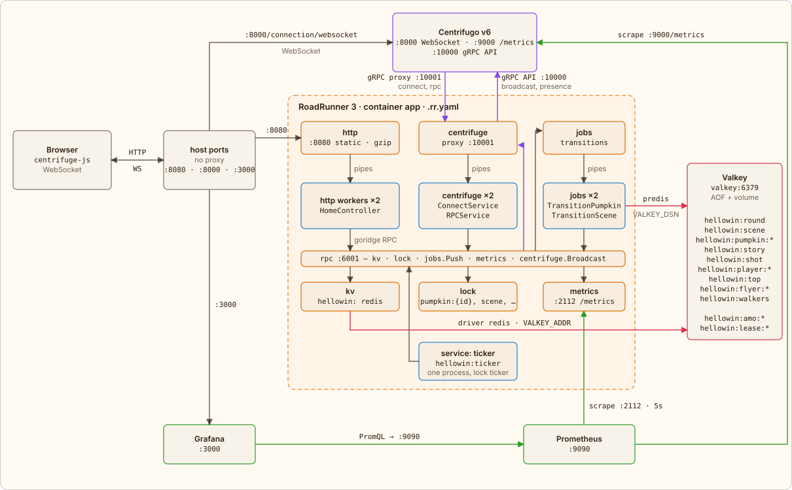

← [RoadRunner](01-roadrunner.md) · [Contents](../../../README.md#how-it-works) · [Page load](03-page-load.md) → | [Русский](../ru/02-modules.md)

# Who talks to whom

There is no nginx in front of RoadRunner: its HTTP plugin serves the pages and static files itself on `localhost:8080`. Its middleware run left to right: `http_metrics`, `headers` (security headers), `gzip`, `static` (files from `public/` with an ETag, so a repeated request gets a 304) and `rate_limiter` (a token bucket per IP, only for requests that make it to PHP). RoadRunner is not a reverse proxy, so Centrifugo and Grafana are exposed on their own ports: WebSocket on `:8000`, the dashboard on `:3000`. The page gets these addresses from the server, built from the host it was opened by. Everything else lives in the internal docker compose network.

This is how it reads in `.rr.yaml`:

[`.rr.yaml`](../../../.rr.yaml) · `http`

```yaml
http:
  # …
  middleware:
    - http_metrics
    - headers
    - gzip
    - static
    - rate_limiter
  headers:
    response:
      X-Powered-By: RoadRunner 3
      X-Content-Type-Options: nosniff
      X-Frame-Options: DENY
      # …
```

The main load is not HTTP but RPC over WebSocket, and the HTTP limiter never sees it. That is why `RPCService` takes a token from the player's bucket before any method: the bucket lives in the KV store `process` (RoadRunner's memory) and is changed under the lock `rate:{group}:{player}`, because KV has no atomic update. Fast clicking gets through, a stream from a script gets, after `burst`, a `rate limited`; the moderator is exempt from the limit.

RoadRunner and Centrifugo are linked by two gRPC channels going in opposite directions. Centrifugo proxies client events (connect, rpc) to the `centrifuge` plugin at `app:10001`, and the application publishes messages through the Centrifugo gRPC API at `centrifugo:10000`.

RoadRunner has three pools of PHP workers, `php app.php` processes: `centrifuge` has `RR_CENTRIFUGE_WORKERS` of them, the others two each: `http` serves the pages, `centrifuge` answers connect and RPC, `jobs` runs the transition jobs from the `transitions` queue (driver `memory`). RoadRunner hands requests and jobs to a worker through pipes, the process's stdin/stdout. Back to the `kv`, `lock`, `jobs`, `metrics` and `centrifuge` plugins the worker goes over goridge RPC on `127.0.0.1:6001`.

The pools and the queue are there too:

[`.rr.yaml`](../../../.rr.yaml) · `centrifuge, jobs`

```yaml
centrifuge:
  proxy_address: 'tcp://0.0.0.0:10001'
  grpc_api_address: '${CENTRIFUGO_GRPC_API:-centrifugo:10000}'
  pool:
    # Every click, shot and move of the room waits for one of these: about two per core
    num_workers: ${RR_CENTRIFUGE_WORKERS:-4}
# …
jobs:
  consume: [transitions]
  pool:
    num_workers: 2
  pipelines:
    transitions:
      driver: memory
```

Flyers, characters and the top shooters are moved by time, not by requests. That is what the `service` plugin is for: RoadRunner keeps one long-lived process `php app.php hellowin:ticker` outside the worker pools and restarts it if it crashes. The ticker reaches the plugins over the same RPC as the workers do, and through the Centrifugo gRPC API it also asks for the channel's presence. A second copy (overlap during a restart) is kept aside by the lock `ticker`, a lease that its owner renews once a second.

The game state lives in Valkey: the ritual and the story, the players and the top shooters, flyers, characters. It is read and written by RoadRunner's KV plugin: the store `hellowin` with the `redis` driver on `VALKEY_ADDR`, which PHP sees as the PSR-16 cache `hellowin`. The transition idempotency keys `hellowin:amo:*` and the stored dice responses `hellowin:lease:*` are written by the workers to the same Valkey directly, via predis (`VALKEY_DSN`): the `spiral/idempotency` package needs an atomic `SET NX EX`, which the KV plugin lacks. The locks (`pumpkin:{id}`, `scene`, `player:{id}`, `flyer:{id}`, `walkers` and others) and the queue live in the memory of the RoadRunner process, which is enough as long as there is a single `app`.



-  gRPC between Centrifugo and RoadRunner, centrifuge.Broadcast
-  to Valkey: the KV plugin and predis
-  metrics: Prometheus scrapes, Grafana queries
-  HTTP, WebSocket, pipes, RPC, jobs.Push

---

← [RoadRunner](01-roadrunner.md) · [Contents](../../../README.md#how-it-works) · [Page load](03-page-load.md) → | [Русский](../ru/02-modules.md)
