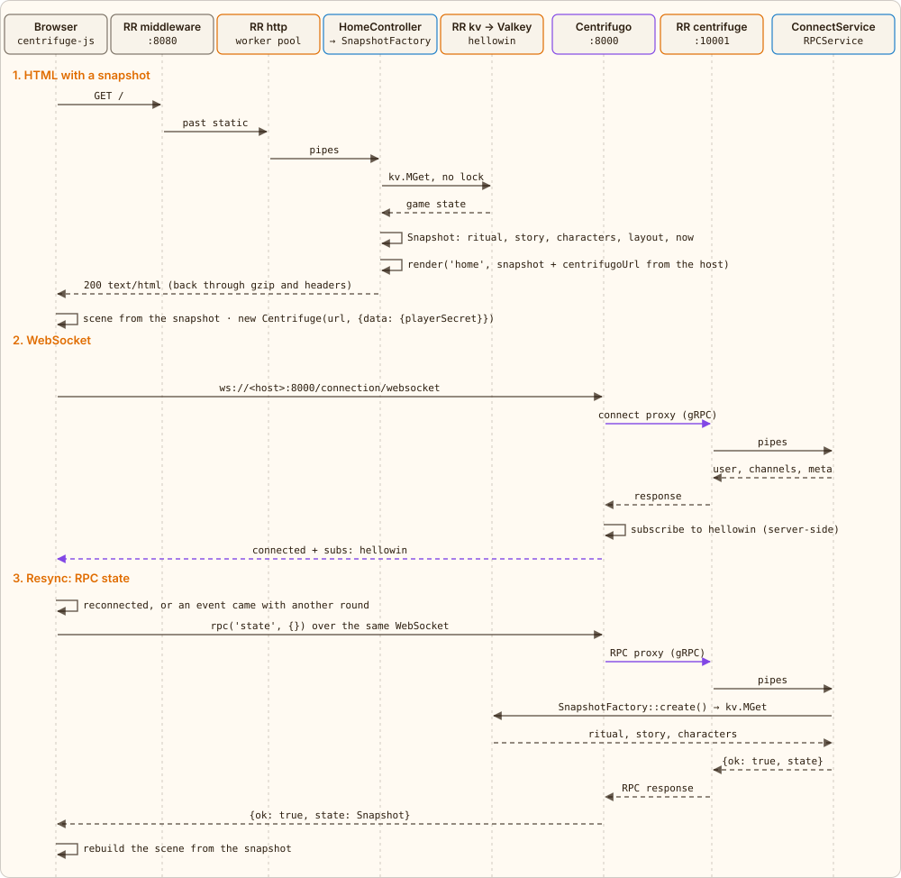

← [Modules](02-modules.md) · [Contents](../../../README.md#how-it-works) · [Click](04-click.md) → | [Русский](../ru/03-page-load.md)

# Page load and connection

`GET /` is plain HTTP. `HomeController::index()` takes a state snapshot from `SnapshotFactory`: `RitualStore::snapshot()` reads in a single `kv.MGet` `hellowin:round`, `hellowin:scene`, the story `hellowin:story` and `hellowin:pumpkin:{id}` of every pumpkin, and one more request fetches the characters `hellowin:walkers`. All of it without locks: the page may lag a click behind, and that is fine. The layout from `app/config/hellowin.php` and the policy numbers are added, and the template gets the snapshot (Snapshot):

- `round`, `scene` — the current round and scene;
- `sceneStages` — the number of the final scene (the length of `HELLOWIN_SCENE_STAGE_MAX`), `stageMax` — a pumpkin's last stage in the current scene;
- `threshold` — a pumpkin's threshold, the `pumpkin` limit ([“Limits”](05-stages.md#limits)); `limits` — the current scene's limits with the number of players `players` and the multiplier `k`;
- `elements` — the pumpkins: `id`, `type`, `x`, `y`, `size`, `stage` and `clicks` since the move to the current stage; `bushes` — the bushes the flyers take off from;
- `walkers` — the players' characters on the field with their paths;
- the story: `ready` — the scene is ready and waits for the moderator, `finale` — the finale step (from the reveal step on, also `reveal`), `paused` — progress is paused;
- `now` — server time in ms: the client uses it to compute its clock offset for the flyers and characters.

Then the browser opens a WebSocket and passes the player's secret from `localStorage` in the connection's `data`: `{playerSecret}`. Centrifugo itself knows nothing about users and asks the application on connect (connect proxy). `ConnectService` answers with `user`, the player's public id derived from the secret (no secret means anonymous), a list `channels: ['hellowin']`, which is a server-side subscription, and the connection's `meta` (the moderator role, see [“Moderator, characters, flyers”](08-live.md)). From then on Centrifugo puts `user` into every RPC itself: the client does not send its id and cannot pose as someone else. The client never calls `subscribe`: client-side subscriptions and publications are disabled in `config.json`, and channel messages arrive in `centrifuge.on('publication')`.

The RPC `state` returns the same snapshot. Every channel event carries `round`: if it does not match the client's round, the client has missed a reset and requests the snapshot again; the same happens after a reconnect, when the events sent during the outage are lost.

*Solid arrows are requests, dashed ones are responses. Purple ones take the path through Centrifugo.*

---

← [Modules](02-modules.md) · [Contents](../../../README.md#how-it-works) · [Click](04-click.md) → | [Русский](../ru/03-page-load.md)
