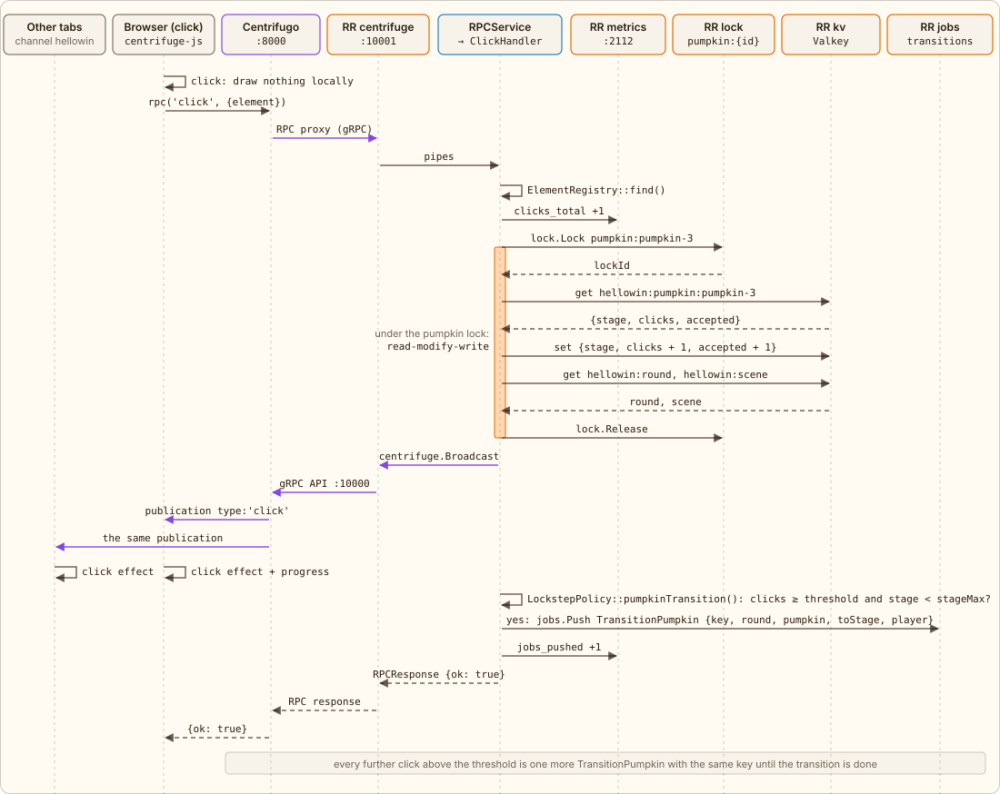

← [Page load](03-page-load.md) · [Contents](../../../README.md#how-it-works) · [Stages and lock](05-stages.md) → | [Русский](../ru/04-click.md)

# What happens on a click

A click is not an HTTP request but an RPC over the same WebSocket: `centrifuge.rpc('click', {element: 'pumpkin-3'})`. Centrifugo proxies it to RoadRunner, which hands the call to a free worker from the `centrifuge` pool, where `RPCService` passes it on to `ClickHandler::click()`.

The answer goes back to Centrifugo through `$request->respond()`, and the call metric is written in `finally`, even if the handler threw:

[`app/src/Endpoint/Centrifugo/RPCService.php`](../../../app/src/Endpoint/Centrifugo/RPCService.php) · `RPCService::handle()`

```php
public function handle(RequestInterface $request): void
{
    \assert($request instanceof RPC);

    $started = \hrtime(true);
    $method = (string) $request->method;
    $result = 'exception';
    try {
        $answer = $this->answer($request, $method);
        $request->respond(new RPCResponse($answer));
        $result = self::result($answer);
    } finally {
        $known = \in_array($method, self::PUBLIC, true) || \in_array($method, self::CONSOLE, true);
        $this->metrics->rpc($known ? $method : 'unknown', $result, (float) (\hrtime(true) - $started) / 1e9);
        // …
    }
}
```

1. The element is checked against `ElementRegistry` (ids from `app/config/hellowin.php`).
2. `RitualMetrics` adds 1 to `hellowin_clicks_total`.
3. `RitualStore::click()`, under the lock `pumpkin:{id}`, increments the pumpkin's `clicks` in KV (and `accepted`, the round's accepted clicks, for the reveal in the finale) and right away, under the same lock, reads the round and the scene. The lock covers only this pumpkin: clicks on different pumpkins do not wait for each other.
4. `PlayerService`, under the lock `player:{id}`, adds the click to the stats of the player, the connection's `user`; an anonymous click skips the stats. A stats failure is logged and does not break the click.
5. `ChannelPublisher` publishes a `click` event to the channel `hellowin` (with `player` unless the click is anonymous), to all subscribers at once.
6. `LockstepPolicy::pumpkinTransition()` decides whether the pumpkin should move on: `clicks` is at least the pumpkin's threshold (the `pumpkin` limit) and the stage is below the current scene's `stageMax`. If so, `TransitionQueue` queues a `TransitionPumpkin` job, and `hellowin_transition_jobs_pushed_total{kind="pumpkin"}` grows by 1.
7. The RPC response is always data: `{ok: true}` or `{ok: false, error: 'unknown element' | 'busy' | 'internal error'}`; `busy` means the pumpkin's lock could not be taken within 5 seconds.

> The click itself does not change the stage, it only queues a job. Until the job is done, `clicks` stays above the threshold, and **every** next click queues one more identical job. The duplicates are intended: idempotency cuts them off, and the clicks above the threshold are burnt. Details are on the tab [“Idempotent transition”](06-idempotency.md).

> The browser does not draw its own click locally. The effect appears only when a publication comes from the channel, for the one who clicked just like for everyone else. That is why the screen shows the honest round trip delay browser → server → browser.



*The orange bar on the worker's line is the time it holds the lock `pumpkin:{id}`. Metrics, publishing and queuing the job happen outside the lock.*

The click event is built by `ChannelPublisher::click()`:

[`app/src/Application/Hellowin/ChannelPublisher.php`](../../../app/src/Application/Hellowin/ChannelPublisher.php) · `ChannelPublisher::click()`

```php
public function click(int $round, Pumpkin $pumpkin, string $emoji, int $threshold, ?Player $player = null, bool $counted = true): void
{
    $this->publish(self::counted(self::withPlayer([
        'type' => 'click',
        'round' => $round,
        'element' => $pumpkin->id,
        'emoji' => $emoji,
        'clicks' => $pumpkin->clicks,
        'threshold' => $threshold,
        'stage' => $pumpkin->stage,
    ], $player), $counted));
}
```

It goes to the channel as a JSON string:

```json
{"type":"click","round":…,"element":"pumpkin-3","emoji":"🕸️","clicks":…,"threshold":…,"stage":…}
```

---

← [Page load](03-page-load.md) · [Contents](../../../README.md#how-it-works) · [Stages and lock](05-stages.md) → | [Русский](../ru/04-click.md)
