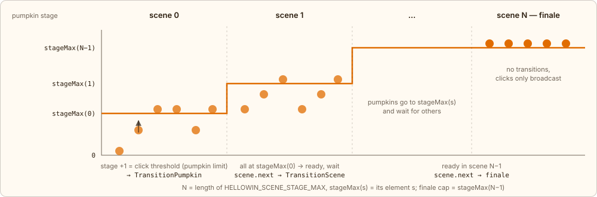
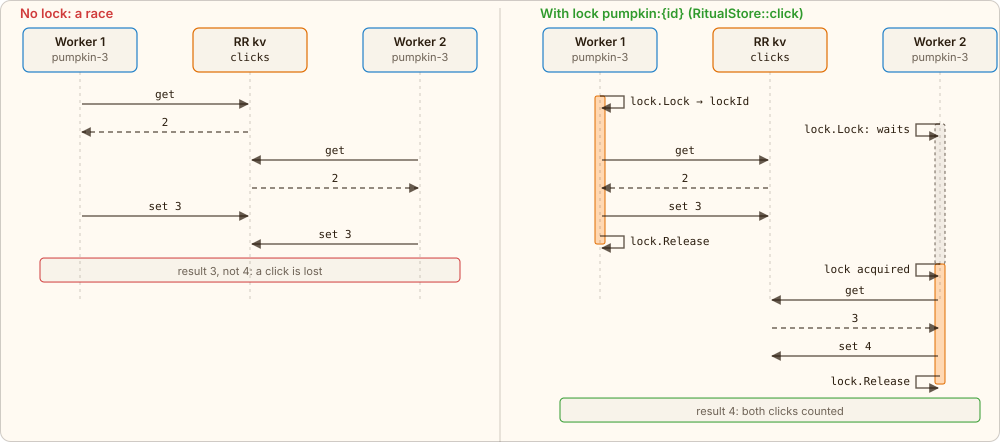
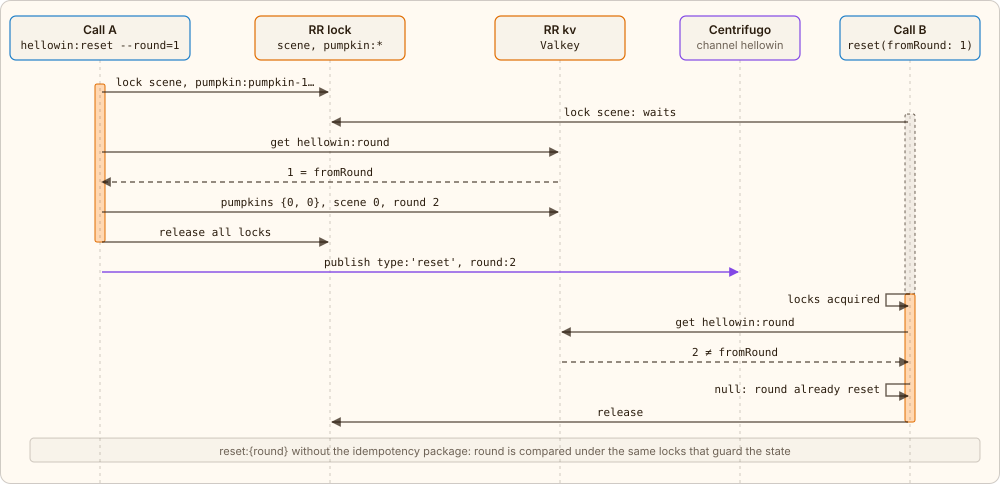

← [Click](04-click.md) · [Contents](../../../README.md#how-it-works) · [Idempotent transition](06-idempotency.md) → | [Русский](../ru/05-stages.md)

# Scenes, pumpkin stages and locks

The engine knows only numbers: `round`, `scene` and, for each pumpkin, `{stage, clicks}`. What it looks like is up to the frontend. When things move is up to the policy — the `RitualPolicy` interface, implemented by `LockstepPolicy`: one spot in the code that can be replaced without touching the engine.

- Scenes are numbered from 0 to the final N — the length of the `HELLOWIN_SCENE_STAGE_MAX` list.
- Scene s has a stage cap `stageMax(s)` — element s of the same list, cumulative; the finale has the same cap as the scene before it.
- If the list starts with 0, scene 0 is the **bar**: there are no pumpkins (clicking them returns `locked`, `RitualPolicy::bar()`); the scene is ready when the crowd has drunk the bar target or the moderator gives the go-ahead, and the moderator leads everyone out to the pumpkin patch. Details in [“The bar”](#bar).
- A pumpkin moves to `stage + 1` once it collects the click threshold — the `pumpkin` limit ([“Limits”](#limits)) — while `stage < stageMax(scene)`; the transition resets `clicks` to zero.
- When **all** pumpkins reach `stageMax`, the scene is **ready** but does not switch by itself: a `ready` event, the owl says “all set”, and the scene waits for the moderator. The “Next scene” button on the control panel (RPC `scene.next`) starts the next one; if the crowd is stuck, the moderator can switch an unready scene too (`force`). Details in [“Scene transition”](06-idempotency.md#scene-transition).
- In the final scene pumpkins do not transition; clicks are only broadcast. The moderator walks through the finale steps, and after the reveal the endless “cursed world” begins.



*The orange step is the stage cap `stageMax(s)`; circles are pumpkins.*

One player on the field, multiplier 1: the threshold is `HELLOWIN_PUMPKIN_BASE` clicks per stage, and this is how a pumpkin goes through a scene:

| 0 | 1 | 2 | … | stageMax |
|---|---|---|---|---|
| round start | after `HELLOWIN_PUMPKIN_BASE` clicks | `HELLOWIN_PUMPKIN_BASE` more | `HELLOWIN_PUMPKIN_BASE` each | waits for the rest |

## <a id="limits"></a>Limits: base, players, multiplier

A pumpkin threshold is not one number for every case: one player clicks through it in a minute, forty in a second. So every number in the ritual — clicks per stage of a pumpkin, the bonfire and the circle, the bar target, both cursed-world targets, FrankenPHP's health — is computed by one formula from the number of players on the field:

`limit = max(1, ⌈k × (BASE + PER_PLAYER × (n − 1))⌉) + bonus`

- **BASE** and **PER_PLAYER** are the element's env vars `HELLOWIN_<X>_BASE` and `HELLOWIN_<X>_PER_PLAYER`, X being `PUMPKIN`, `BONFIRE`, `CIRCLE`, `BAR`, `CURSED_DRINKS`, `CURSED_ZOMBIES`, `BOSS_HP`: how much one player needs and how much each additional player adds. The formula leaves the number of stages alone — only clicks per stage.
- **n** — characters on the field, at least one. `LimitsService` counts them with a ticker once a second and accepts a new n once it has held for `LimitsService::DEBOUNCE`: someone joins and leaves — the limits don't twitch.
- **k** — the moderator's multiplier (RPC `thresholds`), one for all limits: fits the ritual to the crowd on the fly.
- **Bonus** — manual, from the control panel: the bar target, the cursed-world targets, the boss's health. It lasts until the end of the round; click thresholds have none.

When any input changes, `LimitsService::settle` compares the current scene's limits with the last announced ones and, if they differ, publishes a `limits {players, k, burst, limits}` event: browsers update their thresholds, the control panel shows the resulting numbers. A limit that drops below the accumulated count takes no progress away: the server itself queues the stage transition (the same idempotent `TransitionPumpkin` as after a click) or marks the bar and the cursed world ready, without waiting for a click. FrankenPHP keeps its damage: `hp = max(1, max − damage)`.

The same player count grows the flyer wave the moderator launches with the “Launch flyers” button (RPC `flyers.burst`): `⌈HELLOWIN_FLYER_BURST_BASE + HELLOWIN_FLYER_BURST_PER_PLAYER × (n − 1)⌉` flyers of the current set at once. No cooldown, no cap: as many presses, as many waves.

## Why lock a pumpkin

Clicks are handled by several workers in parallel (the `centrifuge` pool has `RR_CENTRIFUGE_WORKERS`), and many people click the same pumpkin. Incrementing the counter is read-modify-write: read `{stage, clicks}`, +1, write; the KV plugin has no atomic increment. Without a lock two workers read the same value, and one click is lost.



*Orange: the worker holds the lock; dashed frame: it waits for it.*

Locks are RoadRunner's `lock` plugin; each operation has its own set. TTL is 5 seconds — the lock expires by itself if a worker dies; waiting for a held one — up to 5 seconds, then `RitualBusyException`.

| Operation | Locks | What is checked under the lock |
|---|---|---|
| click, `RitualStore::click()` | `pumpkin:{id}` | nothing: `clicks + 1`, then reading `round` and `scene` |
| pumpkin transition, `advancePumpkin()` | `pumpkin:{id}` | `round` is current and `stage == toStage − 1` |
| scene readiness, `markReady()` | `scene` | `round` and `scene` are current, this scene's readiness not marked yet |
| scene transition, `advanceScene()` | `scene` | `round` is current and `scene == toScene − 1` |
| control panel: finale step, progress pause, `updateStory()` | `scene` | the story before and after: an event only if it changed |
| reset, `reset()` | `scene` and all `pumpkin:{id}` | `round == fromRound` |
| player stats, `PlayerStore` | `player:{id}` | nothing: player counters + 1 |
| shot, `FlyerStore::shoot()` | `flyer:{id}` | the flyer key still exists and the flight isn't over — then delete it |
| character moves and joins, `WalkerStore::update()` | `walkers` | nothing: read-modify-write of one key holding all characters |
| bar mugs: pouring, “take”, drunk this round, `BarStore` | `bar` (on “take” — inside `walkers`) | the scene is the bar; a mug is still on the counter — the first to arrive gets it |
| cursed-world target: mugs, zombies, bonuses, `CursedStore` | `cursed` | nothing: round counters + 1; both targets met — readiness mark under `scene` |
| rapier strike at FrankenPHP, `BossStore` | `boss` | the boss is awake and still alive — then health − 1 |

A click takes one lock, its pumpkin's, and reads, changes and writes the pumpkin only inside it:

[`app/src/Domain/Ritual/RitualStore.php`](../../../app/src/Domain/Ritual/RitualStore.php) · `RitualStore::click()`

```php
public function click(string $id, ?\Closure $accepts = null, ?\Closure $acceptsIn = null): ?ClickOutcome
{
    $id = $this->known($id);

    return $this->locked([$this->lockOf($id)], function () use ($id, $accepts, $acceptsIn): ?ClickOutcome {
        // …
        $story = $this->readStory();
        $current = $this->readPumpkin($id);
        $clicks = $story->paused ? $current->clicks : $current->clicks + 1;
        $pumpkin = new Pumpkin($id, $current->stage, $clicks, $current->accepted + 1, $current->spent);
        $this->writePumpkin($pumpkin);

        return new ClickOutcome($this->readRound(), $this->readScene(), $pumpkin, $story->k, $story->players, !$story->paused);
    });
}
```

`locked()` takes the plugin's locks in order and releases them in reverse order in `finally`:

[`app/src/Domain/Ritual/RitualStore.php`](../../../app/src/Domain/Ritual/RitualStore.php) · `RitualStore::locked()`

```php
private function locked(array $resources, \Closure $operation): mixed
{
    $held = [];

    try {
        foreach ($resources as $resource) {
            $id = $this->lock->lock($resource, ttl: $this->lockTtl, waitTTL: $this->lockWait);
            $id === false and throw new RitualBusyException(\sprintf('"%s" is locked by another worker.', $resource));
            $held[$resource] = $id;
        }

        return $operation();
    } finally {
        foreach (\array_reverse($held, true) as $resource => $id) {
            $this->lock->release($resource, $id);
        }
    }
}
```

## <a id="bar"></a>The bar: the last mug and pouring in batches

The evening starts in the bar (scene 0): no pumpkins there, but a counter where the owl bartender pours beer. The bar shows two more mechanics — the same lock and KV, but on mugs.

- **The last mug goes to whoever comes first.** A click on the counter (RPC `bar.take`) only sends the character there and writes the arrival time into its record. When that moment comes, the ticker, under the `bar` lock, checks in one step whether a mug is in `hellowin:bar` and takes it off — like “is the flyer alive” for a shot. Two arrive almost at once — the lock lines them up: the first leaves with a beer (`take` with `ok: true`), the second finds an empty counter (`ok: false`, the owl: “all gone”). There is no queue — the latecomer clicks again.
- **Pouring in batches.** While the counter has free places (one per character on the field, up to `HELLOWIN_BAR_MUGS`), the owl pours the next batch for `HELLOWIN_BAR_POUR_MS` ms: a mug for every `HELLOWIN_BAR_POUR_PER` free places, at least one — a big crowd doesn't wait for beer one mug at a time. The batch is decided when the pour starts: KV holds `pouring {since, until, batch}` by server time, a RoadRunner ticker every 200 ms sets down the poured mugs (`mugs`, no more than the places) and starts the next batch (`pour`). Everyone sees the same foam, and restarting the workers or the ticker itself loses nothing: the state lives in Valkey, not in process memory.
- You can drink only from a mug that has clinked (`drink`, otherwise `not clinked`); drinks are counted per round, and once the crowd has drunk the bar target (the moderator adjusts it), the bar is ready and the owl calls everyone to the pumpkin patch. Leaving the bar is a plain `scene.next`: the mugs vanish, the characters move to the lawn in one `scene` event, without walking.

## <a id="rapier"></a>The rapier: the magic word, curing, one boss for the whole crowd

The end of the night shows three more mechanics — again a lock, KV and a server that decides on its own.

- **Only the server checks the word.** The client sends what the player typed (RPC `word`) and learns only the verdict. The server normalizes the input — lowercase, Cyrillic to Latin, only `a-z` — and compares it with the answer, forgiving typos (prefix, Levenshtein distance, `metaphone`). Neither the answer nor the rules are in the browser. Wrong — the character turns into a zombie, and the server's ticker walks it around.
- **Cure first.** A click on a zombie player (RPC `cure`) under the `walkers` lock lifts the spell — the same “check and change in one step” as a shot at a flyer: the second clicker sees the zombie is already gone.
- **One boss for the whole crowd.** All rapier strikes (RPC `strike`) go to one record `hellowin:boss` under one `boss` lock, like clicks on the bonfire: the crowd competes for one resource, and exactly one strike takes the last point of health. That strike queues the transition to dawn with the idempotency key `{round}:finale:7`.

## Round and reset

A reset starts the ritual over: scene 0 (the bar), every pumpkin at `stage 0` and `clicks 0`, `round + 1`, the story from the start (the progress pause is lifted, the multiplier `k` stays) and a `reset` event to everyone. This is done by `ResetService::reset(?int $fromRound)`, called by the “Restart” button on the moderator's control panel (RPC `reset {round}` — the round the moderator sees) and by the CLI command `hellowin:reset [--round=N]`. The service takes the `scene` lock and the locks of all pumpkins, so neither a click nor a transition sees a half-reset ritual, and under them compares the current round with the one being finished. A second reset of the same round sees the new round already and does nothing — idempotency by `reset:{round}` without a separate key: the state is already under these locks, and a key in Valkey would be a second source of truth about the round.



*Orange: the call holds the locks; dashed frame: it waits for them.*

---

← [Click](04-click.md) · [Contents](../../../README.md#how-it-works) · [Idempotent transition](06-idempotency.md) → | [Русский](../ru/05-stages.md)
