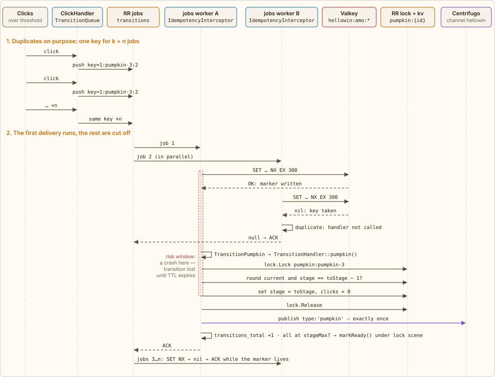
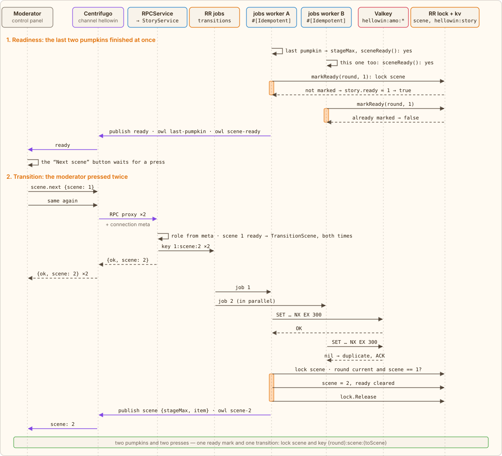

← [Stages and lock](05-stages.md) · [Contents](../../../README.md#how-it-works) · [Dice](07-dice.md) → | [Русский](../ru/06-idempotency.md)

# Idempotent transition

A pumpkin hit its threshold — exactly one transition to the next stage is needed. But clicks don't stop: while the job sits in the queue waiting for a worker, the pumpkin gets clicked n more times, and each click queues `TransitionPumpkin` again. This is on purpose. A click doesn't need to know whether someone queued the job before it: no “transition in flight” flag, and no resetting it if the job got lost (the queue is in memory; on an `app` restart jobs vanish — the next click simply queues a new one). The price of simplicity is k + n jobs per transition, and only one must run.

Duplicates are cut off by the `spiral/idempotency` package. The job class carries an attribute, and `IdempotencyInterceptor` in the queue's `interceptors.consume` chain (`app/config/queue.php`) takes the key from the payload:

[`app/src/Application/Hellowin/Job/TransitionPumpkin.php`](../../../app/src/Application/Hellowin/Job/TransitionPumpkin.php) · `TransitionPumpkin::invoke()`

```php
#[Idempotent(storage: 'transitions', key: 'payload.key')]
final class TransitionPumpkin extends JobHandler
{
    public function invoke(int $round, string $pumpkin, int $toStage, TransitionHandler $transitions, ?string $player = null): void
    {
        $transitions->pumpkin($round, $pumpkin, $toStage, PlayerId::isValid($player) ? $player : null);
    }
}
```

## Who makes up the key

The server builds the key from the meaning of the operation: `TransitionQueue::pumpkinKey()` — `{round}:{pumpkin}:{toStage}`, e.g. `1:pumpkin-3:2` — “in round 1 pumpkin 3 moves to stage 2”. All clicks that queue this transition get the same key independently of each other. This differs from the familiar Stripe-style Idempotency-Key:

|  | Deterministic key (here) | Random client key (Stripe-style) |
|---|---|---|
| Who makes it up | the server, from the operation's data | the client, a UUID per attempt of an action |
| Where it travels | in the job payload, field `key` | the request's `Idempotency-Key` header |
| Who duplicates | different clicks by different people, unaware of each other | the same client on retry: timeout, dropped connection |
| What it protects | one state change: a pumpkin's move to a stage | one request attempt: a payment isn't charged twice |
| Two different intents with one key | impossible: same key, same transition | a client bug: the server checks the request against the first one |

The key goes into the job payload next to the transition data:

[`app/src/Application/Hellowin/TransitionQueue.php`](../../../app/src/Application/Hellowin/TransitionQueue.php) · `TransitionQueue::pumpkinKey(), ::pumpkin()`

```php
public static function pumpkinKey(int $round, string $pumpkin, int $toStage): string
{
    return \sprintf('%d:%s:%d', $round, $pumpkin, $toStage);
}
// …
public function pumpkin(int $round, string $pumpkin, int $toStage, ?string $player = null, string $type = Element::TYPE_PUMPKIN): void
{
    $this->queue->push(TransitionPumpkin::class, [
        'key' => self::pumpkinKey($round, $pumpkin, $toStage),
        'round' => $round,
        'pumpkin' => $pumpkin,
        'toStage' => $toStage,
        'player' => $player,
    ]);
    $this->metrics->jobPushed($type);
}
```

In Valkey the key gets the store prefix and a scope — the handler name, so that keys of different jobs don't collide: `hellowin:amo:App\Application\Hellowin\Job\TransitionPumpkin::handle:1:pumpkin-3:2`.

## How a duplicate is cut off

The `transitions` store in `app/config/idempotency.php` is `RedisAtMostOnceConfig` with the prefix `hellowin:amo:` and `retentionTtl: 300`. Before calling the handler, the driver claims the key with one atomic command `SET {key} M:{token} NX EX 300`. Written — it's the first delivery, the handler runs. The key already existed — a duplicate: the handler isn't called at all, the interceptor returns `null`, and the job is acknowledged (ACK) — it doesn't fail and doesn't go back to the queue. The marker is deleted neither on success nor on error; it expires by TTL on its own.

[`app/config/idempotency.php`](../../../app/config/idempotency.php) · `storages.transitions`

```php
'storages' => [
    'transitions' => new RedisAtMostOnceConfig(
        keyPrefix: 'hellowin:amo:',
        retentionTtl: 300,
    ),
    // …
],
```



*Solid arrows are calls, dashed ones are responses and ACKs. The dashed frame on worker A is the window between the marker and the effect.*

## Why “at most once”

The package has three guarantees, and they are about different things:

| Guarantee | How it works | If the worker dies midway | What it needs |
|---|---|---|---|
| `AtLeastOnce` | a lease on the key while the work runs; the key is closed after the effect | the lease expires, a retry performs the effect again — it may happen twice | an effect that is safe to repeat |
| `AtMostOnce` — chosen | the marker is written **before** the effect and never deleted | the effect is lost, retries are cut off while the marker lives — 0 or 1 times | an atomic `SET NX EX` |
| `ExactlyOnce` | the job record and the effect in one transaction (inbox) | the transaction rolls back entirely, a retry performs the effect anew | the effect and the record in one transactional DB |

`ExactlyOnce` is out of reach here: the effect is a KV write through a RoadRunner plugin plus a publication to Centrifugo, and they share no transaction with the marker. Of the remaining two, a double transition is worse: the pumpkin would skip a stage, and the `pumpkin` event would go out twice. Losing a transition is cheap — the pumpkin stays at the threshold, and people click it on through. Hence `AtMostOnce`.

> The price: if a worker dies between the marker and the stage write (or the pumpkin lock stays held longer than 5 seconds), the transition is lost, and new jobs with the same key are cut off while the marker lives — the pumpkin “gets stuck” at the threshold. So the window is short: `retentionTtl` is 300 seconds, not the default of a day. After it the next click starts the transition again, and a double transition is prevented by the domain check under the lock — `stage == toStage − 1`: if the transition did in fact go through, the retry changes nothing.

## <a id="scene-transition"></a>Scene transition

A scene doesn't switch by itself: the game isn't timed, the moderator runs it. The transition is split into two steps, and each is protected from double execution in its own way.

1. **Readiness.** After each pumpkin transition `TransitionHandler` asks the policy whether all pumpkins have reached `stageMax` (`RitualPolicy::sceneReady()`). The last pumpkins can arrive almost at once, and then several workers hear “yes”. The mark is set by `RitualStore::markReady()` under the `scene` lock: if in the story `hellowin:story` the `ready` field isn't this scene yet, it writes it and returns `true`; if it already is, `false`. So the `ready` event and the owl's lines `last-pumpkin` (with the player who finished off the last pumpkin) and `scene-ready` go out exactly once. The scene itself stays the same.
2. **Readiness with the bonfire.** From scene 2 on, ready pumpkins are not enough: the middle of the patch also has a bonfire, one element for the whole crowd. While the scene's pumpkins aren't ready, clicking it answers `locked` and goes nowhere; instead of readiness, the last pumpkin opens the bonfire (a mark in the story under the same `scene` lock, owl line `bonfire-open`). Then everyone hits one `bonfire` lock — hence the `busy` answers — and past the bonfire threshold (the `bonfire` limit) they queue a handful of duplicates of one `TransitionPumpkin` job with the key `{round}:bonfire:{toStage}`; only one runs, as `kind="bonfire"` shows in the metrics. The scene becomes ready when the bonfire moves to its last stage of the scene (`HELLOWIN_BONFIRE_STAGE_MAX`) — the same `markReady()`, lines `bonfire-done` and `scene-ready`. Likewise, in the final scene the crowd draws the magic circle (lock `circle`, key `{round}:circle:{toStage}`): a closed circle makes the finale ready, and only then does “Finale step” raise FrankenPHP (without readiness — only with `force`).
3. **Transition.** The moderator presses “Next scene” — RPC `scene.next {scene}` with the number of the scene they see. `StoryService::nextScene()` checks against a snapshot that the scene is current, not final and ready (or `force` came), and queues `TransitionScene`. A double click, two control panel tabs or two moderators queue two jobs, and that is the same as duplicate clicks on a pumpkin: the key `{round}:scene:{toScene}` (`TransitionQueue::sceneKey()`), the same `#[Idempotent]` with the `AtMostOnce` guarantee, and inside — the `scene` lock, the check `scene == toScene − 1` and one `scene` event with the new scene's `stageMax` and the characters' item. A press that arrives after the transition sees the scene has changed and queues nothing — it just answers with the current one.



*Orange: a worker holds the `scene` lock. In phase 1 the workers run `TransitionPumpkin`, in phase 2 — `TransitionScene`.*

## Why the key includes the round

After a reset the ritual goes through the same transitions again: pumpkin 3 heads to stage 2 once more. Without the round the key would match the old one, and while the old marker lives, the new transition would be cut off as a duplicate. With the round it is a new operation: `2:pumpkin-3:2`. And jobs from the previous round left in the queue change nothing, even if they get past the marker: the domain check sees the round has changed.

## What you see in Grafana

The dashboard's “Transitions: queue and idempotency” section has the panels “Jobs pushed vs transitions applied” (per minute and total, by `kind`), “Duplicates dropped” = `pushed − transitions` and “Pumpkin stages”. The harder people click a pumpkin at the threshold, the bigger the gap. You can also see the markers in Valkey itself, along with the remaining TTL:

```shell
docker compose exec valkey valkey-cli --scan --pattern 'hellowin:amo:*'
docker compose exec valkey valkey-cli ttl 'hellowin:amo:App\Application\Hellowin\Job\TransitionPumpkin::handle:1:pumpkin-3:2'
```

---

← [Stages and lock](05-stages.md) · [Contents](../../../README.md#how-it-works) · [Dice](07-dice.md) → | [Русский](../ru/06-idempotency.md)
