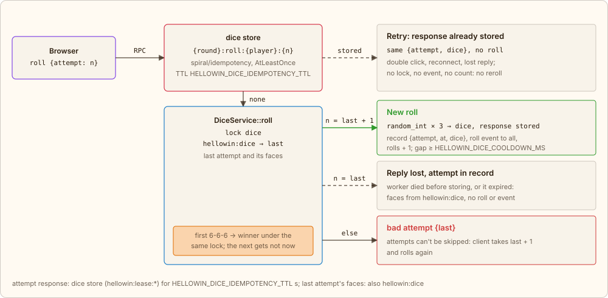

← [Idempotent transition](06-idempotency.md) · [Contents](../../../README.md#how-it-works) · [Moderator, characters, flyers](08-live.md) → | [Русский](../ru/07-dice.md)

# Dice: idempotency with a stored response

Before the uprising in the finale, the crowd rolls three dice until someone gets 6-6-6, a PHP version that never existed. The server does the rolling: the client sends the RPC `roll {attempt}` with its attempt number, and the dice come back in the reply and to everyone in the `roll` event. The problem is the same as with a pumpkin transition: a repeated request must not cause a second effect. But a duplicate transition can simply be dropped, while a repeated roll needs an answer: the same dice. So the attempt's response is *stored*, and the retry gets it.

## A fair roll

The dice are truly random: `DiceRoller` calls `Randomizer::getInt(1, 6)` three times on top of the system CSPRNG, same as `random_int`. Nobody can predict which attempt will hit 6-6-6, the server included. But the same dice can't be computed a second time either: a roll is drawn once, and the result has to be remembered.

## The key and the stored response

The attempt key is `{round}:roll:{player}:{attempt}`: the round, the player's public id and the attempt number. `DiceService::roll` runs the roll through the `dice` store of the `spiral/idempotency` package, a `RedisLeaseConfig` lease with the **AtLeastOnce** guarantee. The first call with a key rolls and stores the response `{attempt, dice}` for `HELLOWIN_DICE_IDEMPOTENCY_TTL` s. A repeat of the same key (a double click, a reconnect, a retry after a lost reply) gets the stored response: no new roll, no event, no count. A refusal (`busy`, `not now`, `bad attempt`) is not a response: `FailurePolicy::Release` frees the key, and the attempt can be rolled once the refusal no longer applies.

In code it is one `execute()` call; `LockedException` means another call is rolling the same attempt right now:

[`app/src/Application/Story/DiceService.php`](../../../app/src/Application/Story/DiceService.php) · `DiceService::roll()`

```php
public function roll(string $id, mixed $attempt): array
{
    // …
    try {
        // A refusal is not an answer: released, so the attempt throws once the refusal is gone
        $answer = $this->replies->execute(
            self::key($round, $id, $attempt),
            $throw,
            new ExecuteOptions(lockTtl: self::LOCK_TTL, ttl: $this->replyTtl, failurePolicy: FailurePolicy::Release),
        );
    } catch (LockedException) {
        throw new StoryRefusedException('busy');
    }
    // …
    return $answer;
}
```

The `dice` store is a lease next to `transitions` in the same config:

[`app/config/idempotency.php`](../../../app/config/idempotency.php) · `storages.dice`

```php
'dice' => new RedisLeaseConfig(
    keyPrefix: 'hellowin:lease:',
    lockTtl: 5,
),
```

The faces of a player's last attempt are also kept in `hellowin:dice` under the `dice` lock, in one record together with the attempt number and the time of the next roll. This is a safety net: AtLeastOnce allows a second run if the worker died before storing the response or the response expired. A run under the lock then finds its attempt in the record and returns those faces without rolling again.



*Green is a new effect, dashed is the same response with no effect, red is a refusal; orange is work under the lock.*

- **Why a retry doesn't reroll.** A retry doesn't roll: it gets the stored response, and if that is gone, its attempt's faces from the record. Only the next attempt brings new dice, and no more often than the `HELLOWIN_DICE_COOLDOWN_MS` pause: nobody can cycle through attempts faster than the rest. Compare with the pumpkin transition: there it is AtMostOnce (`hellowin:amo:`), a `SET NX` marker cuts off the duplicate, which needs no response; here it is an AtLeastOnce lease (`hellowin:lease:`), and the duplicate gets the same response as the first call.
- **The first 6-6-6 is under the lock.** Every roll in the room goes through one record, `hellowin:dice`, under one `dice` lock, like the strikes on FrankenPHP. The winner is recorded by whoever takes the lock first; a second 6-6-6 sees it and gets `not now`, like a second shot at a flyer that is already down. The win makes the finale step ready (`markReady`), and the owl names the winner.
- **The owl.** The moderator's fallback button `dice.owl`: the first two rolls are random, and a 6-6-6 that comes up is rerolled; the third is a guaranteed 6-6-6. There is no idempotency key: each press by the moderator is a new roll. These don't count toward the room's attempts (`reveal.rolls`).

---

← [Idempotent transition](06-idempotency.md) · [Contents](../../../README.md#how-it-works) · [Moderator, characters, flyers](08-live.md) → | [Русский](../ru/07-dice.md)
