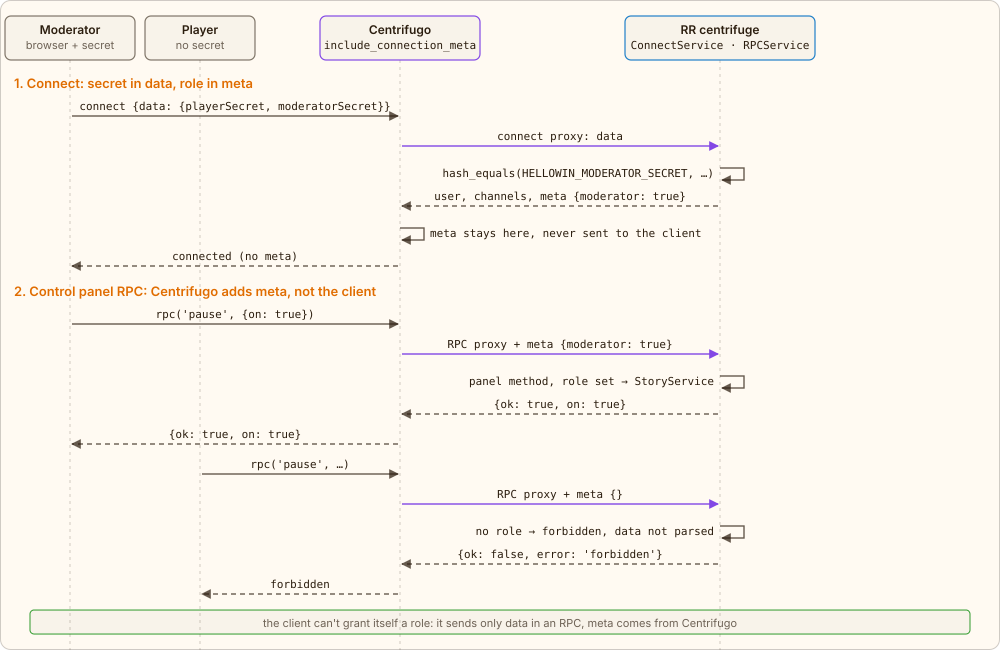
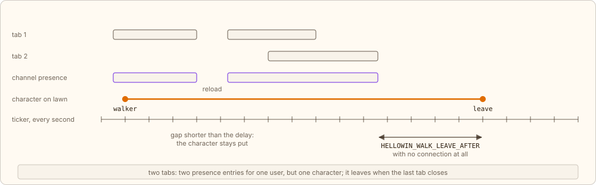
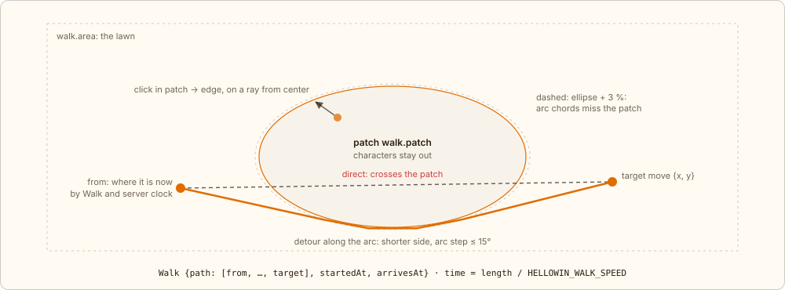
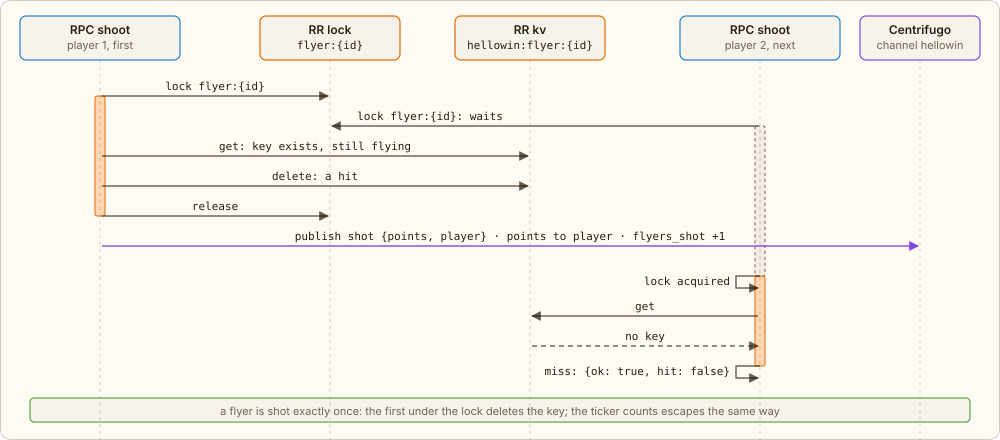

← [Dice](07-dice.md) · [Contents](../../../README.md#how-it-works) · [Metrics](09-metrics.md) → | [Русский](../ru/08-live.md)

# Moderator, characters, flyers

Around the ritual runs a live evening: the moderator drives the story from the control panel, players' characters walk the lawn, birds and spooks fly across the sky, and in the finale the owl lays out the real numbers. Each of these mechanics is one more technique: a role in the connection meta, channel presence, a shared server clock, “first under the lock”, a count derived from state without extra writes.

## <a id="moderator"></a>The moderator role

The moderator opens the page with `?moderator=<secret>`; the page puts the secret into `localStorage`, removes it from the address and passes it in the connection `data` next to the player secret. `ConnectService` compares it with `HELLOWIN_MODERATOR_SECRET` (`hash_equals`) and on a match puts `{moderator: true}` into the connection **meta**. Centrifugo keeps the meta, the client can't see it, and Centrifugo adds it to every RPC proxy call itself, as configured by `rpc.proxy.include_connection_meta` in `config.json`. The client sends only data in an RPC and can't grant itself a role by request. With an empty secret in env, nobody has the role.

`RPCService` reads the role from meta, and for control panel methods (`scene.next`, `finale.step`, `owl.say`, `flyer.special`, `flyers.burst`, `pause`, `thresholds`, `reset`) answers `forbidden` without it, before parsing the data. `thresholds {k}` multiplies all limits by `k` ([“Limits”](05-stages.md#limits)) to fit the ritual to the room on the fly; `k` lives in the story and survives a reset. `pause {on}` pauses progress: the scene's goal freezes while the room carries on. RPCs that advance the goal (`click` on pumpkins, the bonfire and the circle, `drink`, `strike`, `roll`) are not refused: the action goes through and the event reaches everyone, but with `counted: false`: clicks and stages hold, mugs don't count toward the goal, the boss's health stays the same, 6-6-6 doesn't win, and the scene never becomes ready. Players don't see the pause; it shows only on the control panel. Flyers, zombies and shots are not affected by the pause. Lifting the pause catches up through the same recount as a lowered limit, and a reset lifts it by itself. The role is not in `user`: the moderator can also be a player with their own secret, and `user` is the player's public id in events and presence. Every control panel method is safe to repeat: `StoryService` changes the story `hellowin:story` under the `scene` lock, compares “before” and “after”, and publishes the event (and an owl line) only if something changed.



*Solid arrows are requests, dashed are replies. Purple ones are proxy calls from Centrifugo.*

## <a id="walkers"></a>Characters on the lawn: presence and the ticker

A player who has built a character on the entry screen (RPC `register` with a name and `look`) is a character on the lawn. The server doesn't track who is on the page by itself: the `hellowin` channel has Centrifugo presence enabled (`"presence": true` in `config.json`, closed to clients). Every connection is subscribed to the channel by the server, so presence is every open tab with `user` = the player's public id, and an entry disappears on its own as soon as the connection closes.

Once a second, the ticker (`WalkService::sync()`) asks for presence over the Centrifugo gRPC API (`CentrifugoPresence`), reduces the entries to a set of players and, under the `walkers` lock, compares it with the `hellowin:walkers` key: present players get their `seenAt` updated, players with a `look` but no character step onto the lawn (the `walker` event), and characters whose players have been gone longer than `HELLOWIN_WALK_LEAVE_AFTER` ms leave (`leave`). Several tabs mean several entries for one `user`, but there is one character, and it leaves when the last tab closes. The leave delay keeps a page reload from dropping the character or moving it to the edge.



*Rectangles are open connections and presence entries, the orange line is the character on the lawn, the marks are ticks. Lengths are illustrative: the delay is `HELLOWIN_WALK_LEAVE_AFTER`.*

Why not the connect proxy: at connect time the client isn't subscribed to the channel yet and would miss its own `walker` event. Why not the refresh proxy with connection renewal: a departure would show up only when the term expired, and every renewal is an extra call and a KV write. Presence is a ready-made record of connections that Centrifugo cleans up itself on disconnect. A failed presence poll is logged, and the characters stay: an unavailable presence doesn't mean everyone left.

## <a id="walk-path"></a>The server plans the character's path

A click on the ground is only an intent: the RPC `move {x, y}`. Nobody sends coordinates frame by frame. `WalkService::move()` clamps the target into the zone, the lawn rectangle `walk.area` minus the patch ellipse `walk.patch` from `app/config/hellowin.php` (a click inside the patch goes to its edge), starts from where the character is right now according to its current path and the server clock, and builds a polyline: straight if the segment misses the patch, otherwise along a tangent to the ellipse enlarged by 3 %, along its arc and along a tangent to the target, on whichever side is shorter. The duration is the polyline length divided by `HELLOWIN_WALK_SPEED`. Under the `walkers` lock the path is written to `hellowin:walkers`, and the channel gets a `move` event with `Walk {path, startedAt, arrivesAt}`.

The event is built by `ChannelPublisher::move()`, and every channel event leaves through one `publish()`: `BroadcastInterface`, the `centrifuge` plugin, Centrifugo's gRPC API:

[`app/src/Application/Hellowin/ChannelPublisher.php`](../../../app/src/Application/Hellowin/ChannelPublisher.php) · `ChannelPublisher::move(), ::publish()`

```php
public function move(int $round, Walker $walker, ?string $stop = null): void
{
    $message = [
        'type' => 'move',
        'round' => $round,
        'player' => ['id' => $walker->id],
        'walk' => $walker->walk->toArray(),
    ];
    // …

    $this->publish($message);
}

private function publish(array $message): void
{
    $this->broadcast->publish(
        $this->channel,
        \json_encode($message, \JSON_THROW_ON_ERROR | \JSON_UNESCAPED_UNICODE),
    );
}
```



*The orange polyline is the path from the `move` event; every client animates it the same way.*

> The server sets the animation, not the clicking player's client. From `now` in the snapshot, each browser knows its clock offset from the server's and places the character at the point on the path where it should be at that moment of server time. So everyone sees the same movement, and a tab opened mid-walk immediately draws the character halfway along. A new `move` during a walk starts from the current point.

Clinking mugs on click in the cursed world is the same path plus a deferred check: the RPC `clink` walks the character to the target and puts next to it in `hellowin:walkers` a record “waiting to meet by `dueAt`”, and every 200 ms the ticker, under the `walkers` lock, takes the records that are due and, if the target hasn't left, publishes exactly one `clink` event with a toast and the meeting time.

## <a id="flyers"></a>Flyers and zombies: points go to the first

The ticker launches flyers: at random once per `HELLOWIN_FLYER_INTERVAL` ms, the kind taken from the current scene's set `HELLOWIN_FLYER_KINDS`, occasionally a rare one (`HELLOWIN_FLYER_RARE`); the moderator can also release a special one by button or a whole wave (“Launch flyers”, [“Limits”](05-stages.md#limits)). The server sends the trajectory ready-made: a `flyer` event with points, depth, score and the `launchedAt` / `expiresAt` times, and in KV a `hellowin:flyer:{id}` key with a TTL plus an index of flyers in the air. Zombies in the cursed world are flyers too (`kind: zombie`, with their own interval `HELLOWIN_ZOMBIE_INTERVAL`), they just walk across the lawn from the edge of the patch outward, so the shooting, points and metrics are shared. A progress pause doesn't stop the ticker: flyers and zombies keep moving and a hit is credited to the player, only a zombie downed during the pause doesn't count toward the cursed world's goal.

A click on a flyer is the RPC `shoot {flyer}`. Under the `flyer:{id}` lock: if the key still exists, the flyer can be shot and its flight isn't over, the key is deleted and it's a hit: points to the player, one `shot` event, a metric. The next shot won't find the key: a miss. On every tick the ticker accounts for escaped flyers the same way: if the key still exists, delete it and count it as escaped. Exactly one of them deletes the key, so a flyer is never both shot and escaped. The server accepts a shot until `expiresAt` + 500 ms, and the client doesn't draw a flyer whose time has run out by the server clock.

Points add up to the evening's top shooters: `hellowin:top` under the `top` lock (`TopService`). A hit doesn't write “+N” there but the player's absolute score returned by their record, taking `max(old, new)`: a retry or a race can't count twice. The shot itself publishes nothing: the ticker sends the board as a `top {board}` event when it has changed, and no more often than `HELLOWIN_TOP_INTERVAL` ms. This is coalescing: with a full room, the full list to everyone on every hit is too much, while once per interval it is one. The board lives all evening, a reset doesn't clear it, and it is also in the page snapshot.



*Orange: the worker holds the lock; dashed frame: it waits for it.*

## <a id="reveal"></a>The reveal: the evening's numbers

At the finale step where the owl reveals the truth, the `finale` event and the snapshot carry `reveal`, the round's real numbers. There are no separate per-click counters for this: everything follows from the state in Valkey, which is written under locks anyway. `RevealBuilder` recomputes them on every build.

| Number | Source | Why this way |
|---|---|---|
| `clicks`: processed clicks | Σ `accepted` over `hellowin:pumpkin:{id}` | `accepted` grows under the same lock as `clicks` but isn't zeroed on a transition |
| `jobs`: jobs that went through the queue | Σ `stage` + `scene` | every stage and every scene is exactly one executed transition job |
| `burned`: burned clicks | `clicks` − Σ `spent` − Σ min(pumpkin's `clicks`, threshold) | a transition spends exactly the threshold in force when it ran and adds it to the pumpkin's `spent`; the rest was dropped by idempotency or came after the pumpkin was ready, except clicks still piling up toward a transition |
| `shot`: downed flyers and zombies | `hellowin:shot`: `{round, count}` under the `shot` lock | the only separate counter: shots are rare, the lock doesn't get in the way; another round's count reads as 0 |
| `drinks`, `slain`, `damage`: the evening's mugs, zombies and strikes on FrankenPHP | `hellowin:drinks`, `hellowin:cursed`, `hellowin:boss`, each with `round` | the bar, cursed world and boss counters already exist for the game; another round's record reads as empty |
| `lastPumpkin`: who finished the last pumpkin | `lastPumpkin` in `hellowin:story` | the player from the job that marked the scene ready; `null` if the click was anonymous or the scene was switched with `force` |

A round reset zeroes these numbers without dedicated code: `accepted`, `stage`, `scene` and the story are reset along with the ritual, and the shot count is tied to the round.

---

← [Dice](07-dice.md) · [Contents](../../../README.md#how-it-works) · [Metrics](09-metrics.md) → | [Русский](../ru/08-live.md)
