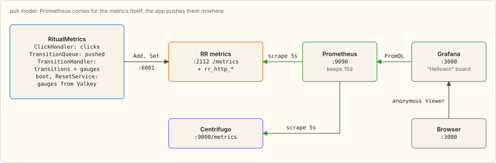

← [Moderator, characters, flyers](08-live.md) · [Contents](../../../README.md#how-it-works) | [Русский](../ru/09-metrics.md)

# Metrics

When a worker starts, `HellowinBootloader` declares the collectors in the `metrics` plugin and sets the gauges from the state in Valkey, which survives a RoadRunner restart. After that, `RitualMetrics` calls `metrics.Add` and `metrics.Set` over RPC from the click, job push, transition and reset, and `PlayMetrics` from the shot and the ticker (flyers, characters, players). A metrics error is only logged: a click never fails because of it. RoadRunner serves everything on `:2112/metrics` along with its own `rr_http_*` (the `http_metrics` middleware in `.rr.yaml`; also there is `gzip`, which compresses both PHP responses and static files; it sits before `static` because RoadRunner 3 runs middleware left to right).

Here is how it looks in code, on the RPC metrics from the [“Click”](04-click.md) tab: collectors are declared once, values are written as things happen:

[`app/src/Application/Hellowin/PlayMetrics.php`](../../../app/src/Application/Hellowin/PlayMetrics.php) · `PlayMetrics::declare(), ::rpc()`

```php
public function declare(): void
{
    $collectors = [
        // …
        self::RPC_CALLS => Collector::counter()->withHelp('RPC calls by method and result: ok or the error code.')->withLabels('method', 'result'),
        self::RPC_DURATION => Collector::histogram(...self::RPC_BUCKETS)->withHelp('RPC handling time in PHP, seconds.')->withLabels('method'),
        // …
    ];

    foreach ($collectors as $name => $collector) {
        $this->safely(fn() => $this->metrics->declare($name, $collector));
    }
}

public function rpc(string $method, string $result, float $seconds): void
{
    $this->safely(fn() => $this->metrics->add(self::RPC_CALLS, 1, [$method, $result]));
    $this->safely(fn() => $this->metrics->observe(self::RPC_DURATION, $seconds, [$method]));
}
```

Every 5 seconds Prometheus scrapes `app:2112` and `centrifugo:9000/metrics` (Centrifugo's internal port: only the WebSocket on 8000 is exposed). Grafana gets the datasource and the “Hellowin” dashboard through provisioning and lets visitors in anonymously as Viewer: anyone can look, nobody can edit.



*Arrows show who initiates the request; on the scrape arrows the data flows back.*

| Metric | Source | Meaning |
|---|---|---|
| `hellowin_clicks_total{type, element}` | ClickHandler | counter: accepted clicks |
| `hellowin_transition_jobs_pushed_total{kind}` | TransitionQueue | counter: transition jobs pushed to the queue, duplicates included; `kind` is `pumpkin` or `scene` |
| `hellowin_transitions_total{kind}` | TransitionHandler | counter: transitions actually executed |
| `hellowin_scene_stage` | TransitionHandler, startup, reset | gauge: current scene |
| `hellowin_round` | startup, reset | gauge: current round |
| `hellowin_pumpkin_stage{element}` | TransitionHandler, startup, reset | gauge: stage of each pumpkin |
| `hellowin_flyers_launched_total{depth}`, `hellowin_flyers_shot_total{depth}`, `hellowin_flyers_escaped_total{depth}` | ticker, RPC `shoot` | counter: flyers (and zombies) launched, shot down, and escaped unshot |
| `hellowin_walkers` | ticker, every second | gauge: characters on the lawn |
| `hellowin_players`, `hellowin_players_registered` | ticker, player count `PlayerCensus` | gauge: known players and players with a name |
| `hellowin_online_players`, `hellowin_online_connections` | `WalkService` ticker, Centrifugo channel presence | gauge: who is online now, unique players and all connections including anonymous ones; the moderator sees the same number on the control panel |
| `hellowin_rpc_calls_total{method, result}` | RPCService | counter: every RPC over the WebSocket; `method` is the method name or `unknown`, `result` is `ok` or an error code |
| `hellowin_rpc_duration_seconds{method}` | RPCService | histogram: how long PHP took to handle the RPC |
| `hellowin_rpc_rate_limited_total{group}` | RPCService | counter: calls rejected by the limit (`rate limited`), by bucket group |
| `hellowin_beer_mugs_total{place}` | BarService | counter: mugs drunk; `place` is `bar` or `cursed` (the cursed world) |
| `hellowin_beer_litres` | ticker, player count `PlayerCensus` | gauge: litres drunk over the evening, players' mugs × `HELLOWIN_MUG_LITRES` |
| `rr_http_request_total`, `rr_http_request_duration_seconds`, `rr_http_workers_*` | RoadRunner http | HTTP requests, latency, workers |
| `centrifugo_node_num_clients`, `centrifugo_transport_messages_sent`, `centrifugo_proxy_duration_seconds_histogram` | Centrifugo | connections, messages sent, latency of proxy calls to RoadRunner |

Counters live in the RoadRunner process and reset when it restarts; gauges are restored from Valkey. Dashboard sections: **Game**: clicks, scene, round, online; **Transitions: queue and idempotency**: jobs versus executed transitions, dropped duplicates, pumpkin stages; **Centrifugo**: connections, messages, proxy calls; **RoadRunner**: HTTP and workers.

Queries from the dashboard, for example:

```promql
# clicks per second, total and per pumpkin
sum(rate(hellowin_clicks_total[1m]))
sum by (element) (rate(hellowin_clicks_total[1m]))

# dropped duplicates: jobs in the queue minus executed transitions
sum by (kind) (hellowin_transition_jobs_pushed_total) - sum by (kind) (hellowin_transitions_total)

# p95 latency of Centrifugo → RoadRunner proxy calls
histogram_quantile(0.95, sum by (le, type) (rate(centrifugo_proxy_duration_seconds_histogram_bucket[1m])))
```

[Open the dashboard in Grafana](http://localhost:3000/) · [Back to the pumpkins](http://localhost:8080/)

---

← [Moderator, characters, flyers](08-live.md) · [Contents](../../../README.md#how-it-works) | [Русский](../ru/09-metrics.md)
