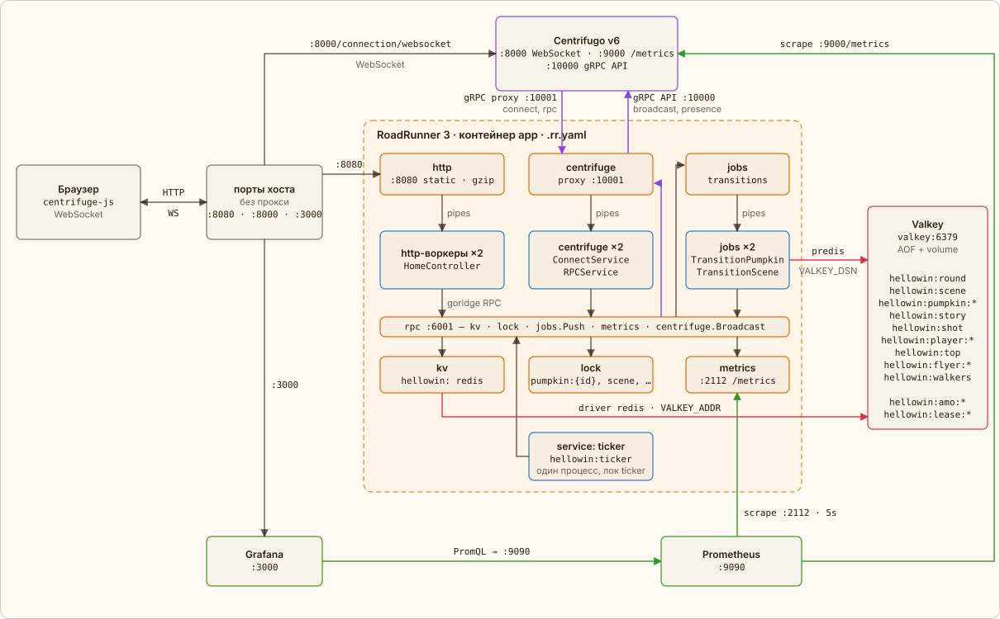

← [RoadRunner](01-roadrunner.md) · [Оглавление](../../../README.ru.md#как-это-работает) · [Загрузка страницы](03-page-load.md) → | [English](../en/02-modules.md)

# Кто с кем разговаривает

Перед RoadRunner нет nginx: страницы и статику отдаёт сам HTTP-плагин на `localhost:8080`. Его middleware идут слева направо: `http_metrics`, `headers` (заголовки безопасности), `gzip`, `static` (файлы `public/` с ETag — повторный запрос получает 304) и `rate_limiter` (token bucket по IP — только для запросов, дошедших до PHP). RoadRunner не реверс-прокси, поэтому Centrifugo и Grafana открыты своими портами: WebSocket — `:8000`, дашборд — `:3000`. Адреса страница получает от сервера, достроенные хостом, по которому её открыли. Всё остальное живёт во внутренней сети docker compose.

Так это записано в `.rr.yaml`:

[`.rr.yaml`](../../../.rr.yaml) · `http`

```yaml
http:
  # …
  middleware:
    - http_metrics
    - headers
    - gzip
    - static
    - rate_limiter
  headers:
    response:
      X-Powered-By: RoadRunner 3
      X-Content-Type-Options: nosniff
      X-Frame-Options: DENY
      # …
```

Основная нагрузка — не HTTP, а RPC через WebSocket, и HTTP-лимитер их не видит. Поэтому `RPCService` до любого метода берёт токен из ведра игрока: оно лежит в KV `process` (память RoadRunner) и меняется под локом `rate:{group}:{player}`, потому что атомарного обновления у KV нет. Быстрые клики проходят, поток из скрипта после `burst` получает `rate limited`; модератора лимит не касается.

RoadRunner и Centrifugo связаны двумя gRPC-каналами в разные стороны. Centrifugo проксирует события клиентов (connect, rpc) в плагин `centrifuge` на `app:10001`, а приложение публикует сообщения через gRPC API Centrifugo на `centrifugo:10000`.

У RoadRunner три пула PHP-воркеров — процессов `php app.php`, в `centrifuge` их `RR_CENTRIFUGE_WORKERS`, в остальных по два: `http` отдаёт страницы, `centrifuge` отвечает на connect и RPC, `jobs` выполняет задачи переходов из очереди `transitions` (драйвер `memory`). Запросы и задачи RoadRunner передаёт воркеру через pipes — stdin/stdout процесса. Обратно к плагинам `kv`, `lock`, `jobs`, `metrics` и `centrifuge` воркер ходит по goridge RPC на `127.0.0.1:6001`.

Пулы и очередь — там же:

[`.rr.yaml`](../../../.rr.yaml) · `centrifuge, jobs`

```yaml
centrifuge:
  proxy_address: 'tcp://0.0.0.0:10001'
  grpc_api_address: '${CENTRIFUGO_GRPC_API:-centrifugo:10000}'
  pool:
    # Every click, shot and move of the room waits for one of these: about two per core
    num_workers: ${RR_CENTRIFUGE_WORKERS:-4}
# …
jobs:
  consume: [transitions]
  pool:
    num_workers: 2
  pipelines:
    transitions:
      driver: memory
```

Летунов, фигурки и топ стрелков двигает время, а не запросы. Для этого есть плагин `service`: RoadRunner держит один долгоживущий процесс `php app.php hellowin:ticker` вне пулов воркеров и перезапускает его при падении. Тикер ходит к плагинам по тому же RPC, что и воркеры, а через gRPC API Centrifugo ещё и спрашивает presence канала. Вторую копию (перекрытие при рестарте) держит в стороне лок `ticker` — лизинг, который владелец продлевает раз в секунду.

Состояние игры — в Valkey: ритуал и сюжет, игроки и топ стрелков, летуны, фигурки. Его читает и пишет KV-плагин RoadRunner: хранилище `hellowin` с драйвером `redis` на `VALKEY_ADDR`, в PHP это PSR-16 кэш `hellowin`. Ключи идемпотентности переходов `hellowin:amo:*` и сохранённые ответы костей `hellowin:lease:*` воркеры пишут в тот же Valkey напрямую, через predis (`VALKEY_DSN`): пакету `spiral/idempotency` нужен атомарный `SET NX EX`, которого у KV-плагина нет. Локи (`pumpkin:{id}`, `scene`, `player:{id}`, `flyer:{id}`, `walkers` и другие) и очередь живут в памяти процесса RoadRunner — этого хватает, пока `app` один.



-  gRPC между Centrifugo и RoadRunner, centrifuge.Broadcast
-  в Valkey: KV-плагин и predis
-  метрики: Prometheus скрейпит, Grafana спрашивает
-  HTTP, WebSocket, pipes, RPC, jobs.Push

---

← [RoadRunner](01-roadrunner.md) · [Оглавление](../../../README.ru.md#как-это-работает) · [Загрузка страницы](03-page-load.md) → | [English](../en/02-modules.md)
