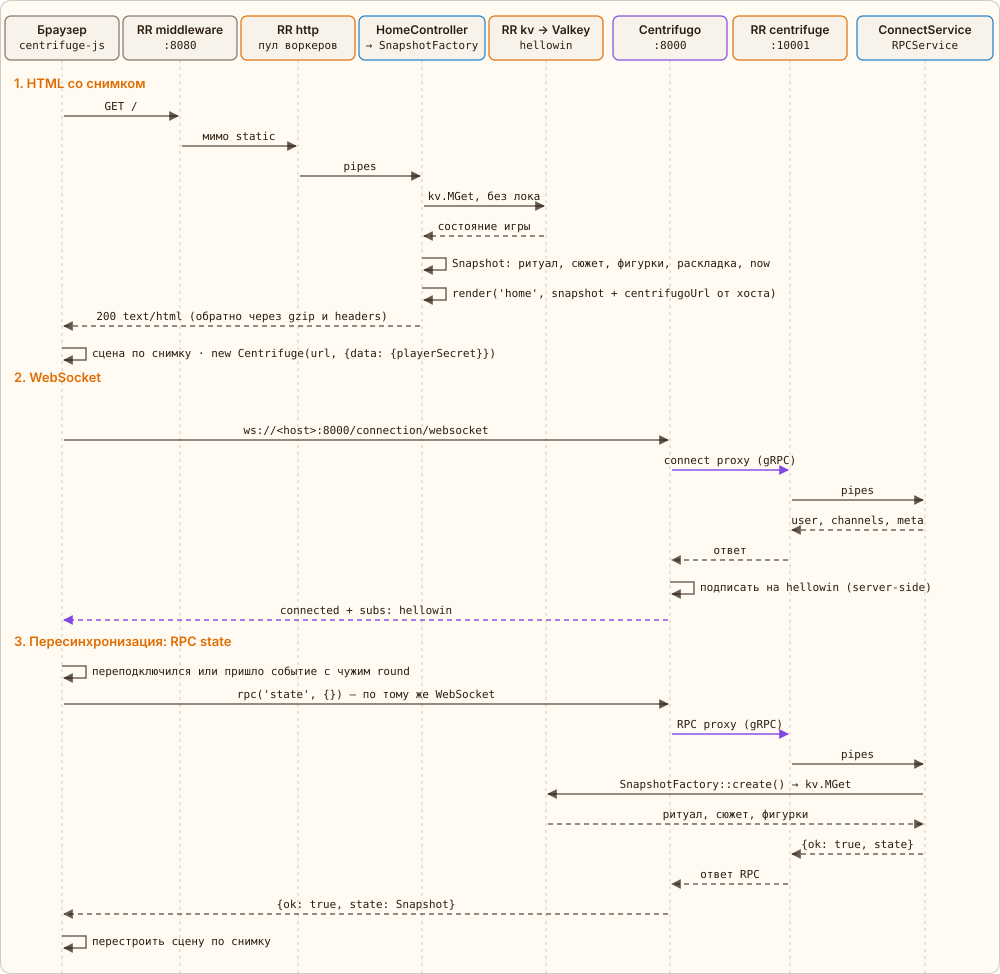

← [Модули](02-modules.md) · [Оглавление](../../../README.ru.md#как-это-работает) · [Клик](04-click.md) → | [English](../en/03-page-load.md)

# Загрузка страницы и подключение

`GET /` — обычный HTTP. `HomeController::index()` берёт снимок состояния у `SnapshotFactory`: `RitualStore::snapshot()` одним `kv.MGet` читает `hellowin:round`, `hellowin:scene`, сюжет `hellowin:story` и `hellowin:pumpkin:{id}` всех тыкв, ещё один запрос — фигурки `hellowin:walkers`. Всё без локов: страница может отстать на клик, это не страшно. К ним добавляются раскладка из `app/config/hellowin.php` и числа политики, и шаблон получает снимок (Snapshot):

- `round`, `scene` — текущий раунд и сцена;
- `sceneStages` — номер финальной сцены (длина `HELLOWIN_SCENE_STAGE_MAX`), `stageMax` — последняя стадия тыквы в текущей сцене;
- `threshold` — порог тыквы, лимит `pumpkin` ([«Лимиты»](05-stages.md#limits)); `limits` — лимиты текущей сцены с числом игроков `players` и множителем `k`;
- `elements` — тыквы: `id`, `type`, `x`, `y`, `size`, `stage` и `clicks` с момента перехода в текущую стадию; `bushes` — кусты, из которых взлетают летуны;
- `walkers` — фигурки игроков на поле с их путями;
- сюжет: `ready` — сцена готова и ждёт модератора, `finale` — шаг финала (с шага разоблачения — и `reveal`), `paused` — пауза прогресса;
- `now` — серверное время в мс: по нему клиент считает смещение своих часов для летунов и фигурок.

Затем браузер открывает WebSocket и передаёт в `data` подключения секрет игрока из `localStorage`: `{playerSecret}`. Centrifugo сам о пользователях ничего не знает и на connect спрашивает приложение (connect proxy). `ConnectService` отвечает `user` — публичным id игрока, вычисленным из секрета (без секрета — анонимно), списком `channels: ['hellowin']` — это server-side подписка — и `meta` подключения (роль модератора, см. [«Модератор, фигурки, летуны»](08-live.md)). Дальше Centrifugo сам подставляет `user` в каждый RPC: клиент не шлёт свой id и не может выдать себя за другого. Клиент сам `subscribe` не вызывает: в `config.json` клиентские подписки и публикации запрещены, сообщения канала приходят в `centrifuge.on('publication')`.

Тот же снимок отдаёт RPC `state`. Каждое событие канала несёт `round`: если он не совпал с раундом клиента, клиент пропустил сброс и перезапрашивает снимок; так же — после переподключения, когда события за время обрыва потеряны.

*Сплошные стрелки — запросы, пунктир — ответы. Фиолетовые — путь через Centrifugo.*

---

← [Модули](02-modules.md) · [Оглавление](../../../README.ru.md#как-это-работает) · [Клик](04-click.md) → | [English](../en/03-page-load.md)
