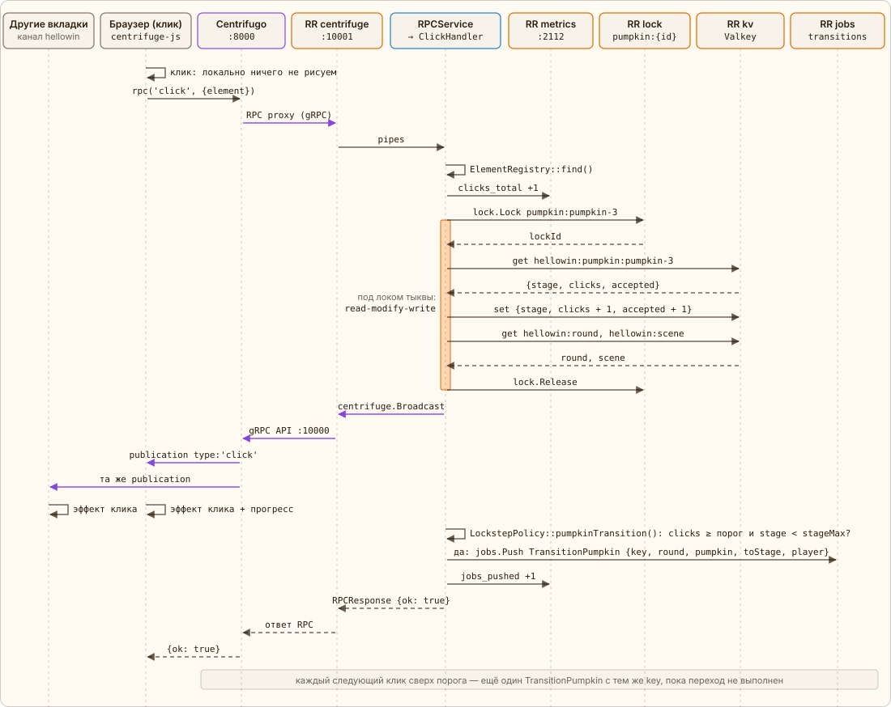

← [Загрузка страницы](03-page-load.md) · [Оглавление](../../../README.ru.md#как-это-работает) · [Стадии и лок](05-stages.md) → | [English](../en/04-click.md)

# Что происходит при клике

Клик — не HTTP-запрос, а RPC поверх того же WebSocket: `centrifuge.rpc('click', {element: 'pumpkin-3'})`. Centrifugo проксирует его в RoadRunner, тот отдаёт вызов свободному воркеру из пула `centrifuge`, где `RPCService` передаёт его в `ClickHandler::click()`.

Ответ уходит в Centrifugo через `$request->respond()`, а метрика вызова пишется в `finally` — даже если обработчик бросил исключение:

[`app/src/Endpoint/Centrifugo/RPCService.php`](../../../app/src/Endpoint/Centrifugo/RPCService.php) · `RPCService::handle()`

```php
public function handle(RequestInterface $request): void
{
    \assert($request instanceof RPC);

    $started = \hrtime(true);
    $method = (string) $request->method;
    $result = 'exception';
    try {
        $answer = $this->answer($request, $method);
        $request->respond(new RPCResponse($answer));
        $result = self::result($answer);
    } finally {
        $known = \in_array($method, self::PUBLIC, true) || \in_array($method, self::CONSOLE, true);
        $this->metrics->rpc($known ? $method : 'unknown', $result, (float) (\hrtime(true) - $started) / 1e9);
        // …
    }
}
```

1. Элемент проверяется по `ElementRegistry` (id из `app/config/hellowin.php`).
2. `RitualMetrics` добавляет 1 к `hellowin_clicks_total`.
3. `RitualStore::click()` под локом `pumpkin:{id}` увеличивает `clicks` тыквы в KV (и `accepted` — принятые клики раунда, для разоблачения в финале) и тут же, под тем же локом, читает раунд и сцену. Лок только на эту тыкву: клики по разным тыквам друг друга не ждут.
4. `PlayerService` под локом `player:{id}` добавляет клик в статистику игрока — `user` подключения; анонимный клик статистику пропускает. Сбой статистики пишется в лог и клик не ломает.
5. `ChannelPublisher` публикует в канал `hellowin` событие `click` (с `player`, если клик не анонимный) — всем подписчикам сразу.
6. `LockstepPolicy::pumpkinTransition()` решает, пора ли тыкве дальше: `clicks` не меньше порога тыквы (лимит `pumpkin`) и стадия ниже `stageMax` текущей сцены. Если да, `TransitionQueue` ставит в очередь задачу `TransitionPumpkin`, а `hellowin_transition_jobs_pushed_total{kind="pumpkin"}` растёт на 1.
7. Ответ RPC — всегда данные: `{ok: true}` или `{ok: false, error: 'unknown element' | 'busy' | 'internal error'}`; `busy` — лок тыквы не удалось взять за 5 секунд.

> Сам клик стадию не меняет — он только ставит задачу. Пока задача не выполнена, `clicks` остаётся выше порога, и **каждый** следующий клик ставит ещё одну такую же задачу. Дубли намеренные: их отсекает идемпотентность, а клики сверх порога сгорают. Подробно — на вкладке [«Идемпотентный переход»](06-idempotency.md).

> Свой клик браузер локально не рисует. Эффект появляется, только когда из канала приходит publication — у кликнувшего так же, как у всех. Поэтому на экране видна честная задержка круга браузер → сервер → браузер.



*Оранжевая полоса на линии воркера — время, пока он держит лок `pumpkin:{id}`. Метрики, публикация и постановка задачи — вне лока.*

Событие клика собирает `ChannelPublisher::click()`:

[`app/src/Application/Hellowin/ChannelPublisher.php`](../../../app/src/Application/Hellowin/ChannelPublisher.php) · `ChannelPublisher::click()`

```php
public function click(int $round, Pumpkin $pumpkin, string $emoji, int $threshold, ?Player $player = null, bool $counted = true): void
{
    $this->publish(self::counted(self::withPlayer([
        'type' => 'click',
        'round' => $round,
        'element' => $pumpkin->id,
        'emoji' => $emoji,
        'clicks' => $pumpkin->clicks,
        'threshold' => $threshold,
        'stage' => $pumpkin->stage,
    ], $player), $counted));
}
```

В канал оно уходит JSON-строкой:

```json
{"type":"click","round":…,"element":"pumpkin-3","emoji":"🕸️","clicks":…,"threshold":…,"stage":…}
```

---

← [Загрузка страницы](03-page-load.md) · [Оглавление](../../../README.ru.md#как-это-работает) · [Стадии и лок](05-stages.md) → | [English](../en/04-click.md)
