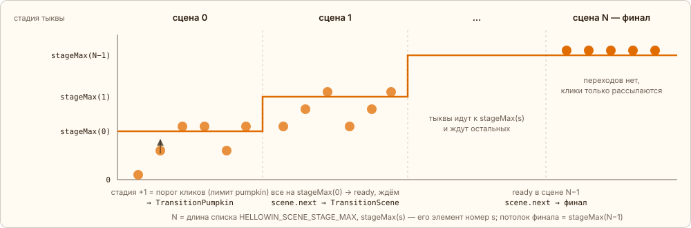
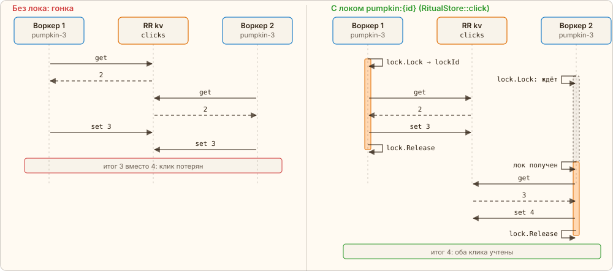
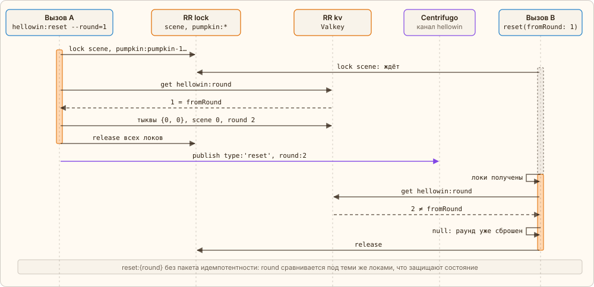

← [Клик](04-click.md) · [Оглавление](../../../README.ru.md#как-это-работает) · [Идемпотентный переход](06-idempotency.md) → | [English](../en/05-stages.md)

# Сцены, стадии тыкв и локи

Движок знает только номера: `round`, `scene` и у каждой тыквы `{stage, clicks}`. Как это выглядит, решает фронтенд. Когда что двигается, решает политика — интерфейс `RitualPolicy`, реализация `LockstepPolicy`: одна точка в коде, её можно заменить, не трогая движок.

- Сцены нумеруются от 0 до финальной N — это длина списка `HELLOWIN_SCENE_STAGE_MAX`.
- У сцены s потолок стадий `stageMax(s)` — элемент номер s того же списка, накопительно; у финала — тот же, что у сцены перед ним.
- Если список начинается с 0, сцена 0 — **бар**: тыкв там нет (клик по ним — `locked`, `RitualPolicy::bar()`), сцена готова, когда зал выпил цель бара или модератор дал отмашку, — и он выводит всех на грядку. Подробно — [«Бар»](#bar).
- Тыква переходит в `stage + 1`, набрав порог кликов — лимит `pumpkin` ([«Лимиты»](#limits)), — пока `stage < stageMax(scene)`; переход обнуляет `clicks`.
- Когда **все** тыквы дошли до `stageMax`, сцена **готова**, но сама не переключается: событие `ready`, сова говорит «всё готово», и сцена ждёт модератора. Следующую включает кнопка пульта «Следующая сцена» (RPC `scene.next`); если зал застрял, модератор может переключить и неготовую сцену (`force`). Подробно — [«Переход сцены»](06-idempotency.md#scene-transition).
- В финальной сцене тыквы не переходят, клики только рассылаются. Модератор ведёт шаги финала, а после разоблачения начинается бесконечный «проклятый мир».



*Оранжевая ступенька — потолок стадий `stageMax(s)`; кружки — тыквы.*

Игрок один на поле, множитель — 1: порог — `HELLOWIN_PUMPKIN_BASE` кликов на каждую стадию, так проходит тыква внутри сцены:

| 0 | 1 | 2 | … | stageMax |
|---|---|---|---|---|
| старт раунда | с `HELLOWIN_PUMPKIN_BASE` кликов | ещё `HELLOWIN_PUMPKIN_BASE` | по `HELLOWIN_PUMPKIN_BASE` | ждёт остальных |

## <a id="limits"></a>Лимиты: база, игроки, множитель

Порог тыквы — не одно число на все случаи: один игрок прокликает его за минуту, а сорок — за секунду. Поэтому все числа ритуала — клики на стадию тыквы, костра и круга, цель бара, обе цели проклятого мира, здоровье FrankenPHP — считаются одной формулой от числа игроков на поле:

`лимит = max(1, ⌈k × (BASE + PER_PLAYER × (n − 1))⌉) + надбавка`

- **BASE** и **PER_PLAYER** — env элемента `HELLOWIN_<X>_BASE` и `HELLOWIN_<X>_PER_PLAYER`, X — `PUMPKIN`, `BONFIRE`, `CIRCLE`, `BAR`, `CURSED_DRINKS`, `CURSED_ZOMBIES`, `BOSS_HP`: сколько нужно одному и сколько прибавляет каждый следующий. Число стадий формула не трогает — только клики на стадию.
- **n** — фигурки на поле, не меньше одной. `LimitsService` считает их тикером раз в секунду и принимает новое n, когда оно продержалось `LimitsService::DEBOUNCE`: зашёл и вышел — лимиты не дёргаются.
- **k** — множитель модератора (RPC `thresholds`), один на все лимиты: подогнать ритуал под зал на ходу.
- **Надбавка** — ручная, с пульта: цель бара, цели проклятого мира, здоровье босса. Живёт до конца раунда; у кликовых порогов её нет.

Изменился любой из входов — `LimitsService::settle` сравнивает лимиты текущей сцены с последними сказанными и, если они разошлись, публикует событие `limits {players, k, burst, limits}`: браузеры обновляют пороги, пульт показывает получившиеся числа. Лимит, упавший ниже накопленного, прогресс не отнимает: сервер сам ставит переход стадии (тот же идемпотентный `TransitionPumpkin`, что и после клика) или готовность бара и проклятого мира, не дожидаясь клика. У FrankenPHP сохраняется урон: `hp = max(1, max − урон)`.

Тем же числом игроков растёт волна летунов, которую модератор запускает кнопкой «Пуск летунов» (RPC `flyers.burst`): `⌈HELLOWIN_FLYER_BURST_BASE + HELLOWIN_FLYER_BURST_PER_PLAYER × (n − 1)⌉` летунов текущего набора разом. Ни кулдауна, ни потолка: сколько раз нажал — столько волн.

## Зачем лок на тыкву

Клики обрабатывают несколько воркеров параллельно (в пуле `centrifuge` их `RR_CENTRIFUGE_WORKERS`), и по одной тыкве кликают многие. Увеличение счётчика — read-modify-write: прочитать `{stage, clicks}`, +1, записать; атомарного инкремента у KV-плагина нет. Без лока два воркера прочитают одно и то же значение, и один клик пропадёт.



*Оранжевое — воркер держит лок, пунктирная рамка — ждёт его.*

Локи — плагин `lock` RoadRunner, у каждой операции свой набор. TTL 5 секунд — лок сам истечёт, если воркер упал; ждать занятый — до 5 секунд, дальше `RitualBusyException`.

| Операция | Локи | Что проверяется под локом |
|---|---|---|
| клик, `RitualStore::click()` | `pumpkin:{id}` | ничего: `clicks + 1`, затем чтение `round` и `scene` |
| переход тыквы, `advancePumpkin()` | `pumpkin:{id}` | `round` текущий и `stage == toStage − 1` |
| готовность сцены, `markReady()` | `scene` | `round` и `scene` текущие, готовность этой сцены ещё не отмечена |
| переход сцены, `advanceScene()` | `scene` | `round` текущий и `scene == toScene − 1` |
| пульт: шаг финала, пауза прогресса, `updateStory()` | `scene` | сюжет до и после: событие — только если изменился |
| сброс, `reset()` | `scene` и все `pumpkin:{id}` | `round == fromRound` |
| статистика игрока, `PlayerStore` | `player:{id}` | ничего: счётчики игрока + 1 |
| выстрел, `FlyerStore::shoot()` | `flyer:{id}` | ключ летуна ещё есть и полёт не кончился — тогда удалить |
| ход и вход фигурок, `WalkerStore::update()` | `walkers` | ничего: read-modify-write одного ключа со всеми фигурками |
| кружки бара: розлив, «взять», выпитые за раунд, `BarStore` | `bar` (при «взять» — внутри `walkers`) | сцена — бар; кружка на стойке ещё есть — её получает первый дошедший |
| цель проклятого мира: кружки, зомби, добавки, `CursedStore` | `cursed` | ничего: счётчики раунда + 1; обе цели выполнены — отметка готовности под `scene` |
| удар рапирой по FrankenPHP, `BossStore` | `boss` | босс проснулся и ещё жив — тогда здоровье − 1 |

Клик берёт один лок — своей тыквы — и читает, меняет и пишет её только внутри него:

[`app/src/Domain/Ritual/RitualStore.php`](../../../app/src/Domain/Ritual/RitualStore.php) · `RitualStore::click()`

```php
public function click(string $id, ?\Closure $accepts = null, ?\Closure $acceptsIn = null): ?ClickOutcome
{
    $id = $this->known($id);

    return $this->locked([$this->lockOf($id)], function () use ($id, $accepts, $acceptsIn): ?ClickOutcome {
        // …
        $story = $this->readStory();
        $current = $this->readPumpkin($id);
        $clicks = $story->paused ? $current->clicks : $current->clicks + 1;
        $pumpkin = new Pumpkin($id, $current->stage, $clicks, $current->accepted + 1, $current->spent);
        $this->writePumpkin($pumpkin);

        return new ClickOutcome($this->readRound(), $this->readScene(), $pumpkin, $story->k, $story->players, !$story->paused);
    });
}
```

`locked()` берёт локи плагина по порядку и отпускает их в обратном порядке в `finally`:

[`app/src/Domain/Ritual/RitualStore.php`](../../../app/src/Domain/Ritual/RitualStore.php) · `RitualStore::locked()`

```php
private function locked(array $resources, \Closure $operation): mixed
{
    $held = [];

    try {
        foreach ($resources as $resource) {
            $id = $this->lock->lock($resource, ttl: $this->lockTtl, waitTTL: $this->lockWait);
            $id === false and throw new RitualBusyException(\sprintf('"%s" is locked by another worker.', $resource));
            $held[$resource] = $id;
        }

        return $operation();
    } finally {
        foreach (\array_reverse($held, true) as $resource => $id) {
            $this->lock->release($resource, $id);
        }
    }
}
```

## <a id="bar"></a>Бар: последняя кружка и розлив партиями

Вечер начинается в баре (сцена 0): там нет тыкв, зато есть стойка, за которой сова-бармен наливает пиво. Бар показывает ещё две механики — те же лок и KV, но на кружках.

- **Последнюю кружку забирает первый.** Клик по стойке (RPC `bar.take`) только отправляет персонажа к ней и пишет в его запись момент прибытия. Когда он наступил, тикер под локом `bar` одним шагом проверяет, есть ли кружка в `hellowin:bar`, и списывает её — как «жив ли летун» у выстрела. Двое дошли почти одновременно — лок выстраивает их по очереди: первый уходит с пивом (`take` с `ok: true`), второй застаёт пустую стойку (`ok: false`, сова: «кончилось»). Очереди нет — опоздавший кликает снова.
- **Розлив партиями.** Пока на стойке есть свободные места (их столько, сколько фигурок на поле, но не больше `HELLOWIN_BAR_MUGS`), сова наливает следующую партию `HELLOWIN_BAR_POUR_MS` мс: по кружке на каждые `HELLOWIN_BAR_POUR_PER` свободных мест, но не меньше одной — большой зал не ждёт пива по одной кружке. Партия решается в начале розлива: в KV лежит `pouring {since, until, batch}` по серверным часам, тикер RoadRunner раз в 200 мс ставит налитые кружки (`mugs`, не больше мест) и начинает следующую партию (`pour`). Все видят одну и ту же пену, а перезапуск воркеров или самого тикера ничего не теряет: состояние — в Valkey, а не в памяти процесса.
- Пить можно только чокнувшейся кружкой (`drink`, иначе `not clinked`); выпитое считается за раунд, и когда зал выпил цель бара (её двигает модератор) — бар готов, сова зовёт всех на грядку. Переход из бара — обычный `scene.next`: кружки сгорают, фигурки переходят на лужайку одним событием `scene`, без ходьбы.

## <a id="rapier"></a>Рапира: слово, расколдовать, один босс на весь зал

Конец ночи показывает ещё три механики — и снова лок, KV и сервер, который решает сам.

- **Слово проверяет только сервер.** Клиент шлёт то, что набрал игрок (RPC `word`), и узнаёт только ответ. Сервер нормализует ввод — нижний регистр, кириллица в латиницу, только `a-z` — и сравнивает с ответом с поблажкой на опечатку (префикс, расстояние Левенштейна, `metaphone`). Ни ответа, ни правил в браузере нет. Неверно — фигурка становится зомби, и её водит тикер сервера.
- **Расколдовать первым.** Клик по зомби-игроку (RPC `cure`) под локом `walkers` снимает с него заклятие — тот же «проверить и изменить одним шагом», что у выстрела по летуну: второй кликнувший видит, что зомби уже нет.
- **Один босс на весь зал.** Все удары рапирой (RPC `strike`) идут в одну запись `hellowin:boss` под одним локом `boss`, как клики по костру: зал конкурирует за один ресурс, и удар, отнявший последнюю единицу здоровья, — ровно один. Он и ставит в очередь переход на рассвет с ключом идемпотентности `{round}:finale:7`.

## Раунд и сброс

Сброс начинает ритуал заново: сцена 0 (бар), у всех тыкв `stage 0` и `clicks 0`, `round + 1`, сюжет заново (пауза прогресса снимается, множитель `k` остаётся) и событие `reset` всем. Делает это `ResetService::reset(?int $fromRound)`, его вызывают кнопка «Заново» на пульте модератора (RPC `reset {round}` — раунд, который модератор видит) и консольная команда `hellowin:reset [--round=N]`. Сервис берёт лок `scene` и локи всех тыкв, поэтому ни клик, ни переход не увидят полусброшенный ритуал, и под ними сравнивает текущий раунд с тем, который хотят завершить. Второй сброс того же раунда видит уже новый раунд и ничего не делает — это идемпотентность по `reset:{round}` без отдельного ключа: состояние и так под этими локами, а ключ в Valkey стал бы вторым источником правды о раунде.



*Оранжевое — вызов держит локи, пунктирная рамка — ждёт их.*

---

← [Клик](04-click.md) · [Оглавление](../../../README.ru.md#как-это-работает) · [Идемпотентный переход](06-idempotency.md) → | [English](../en/05-stages.md)
