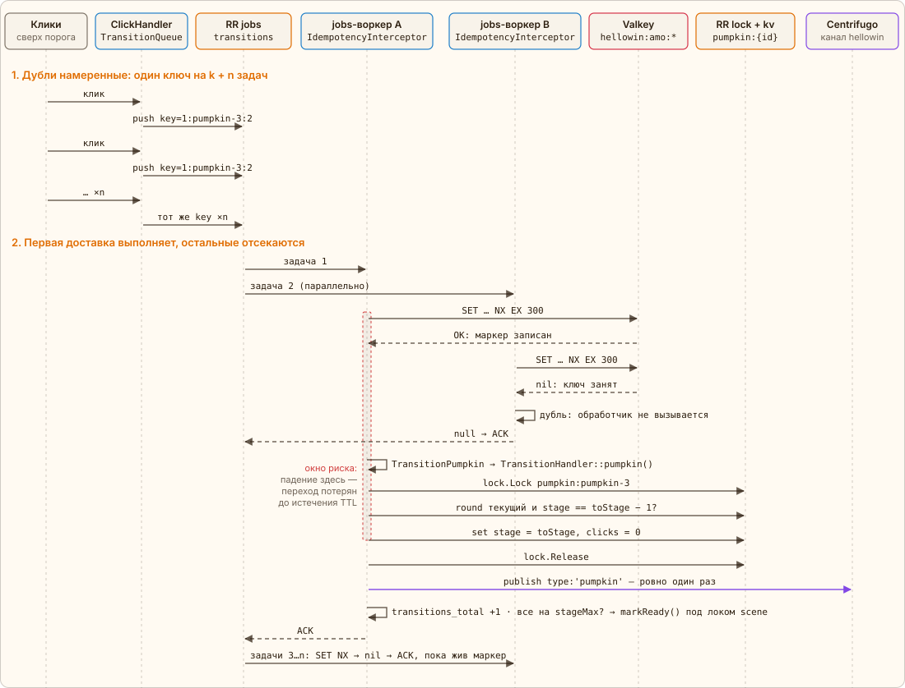
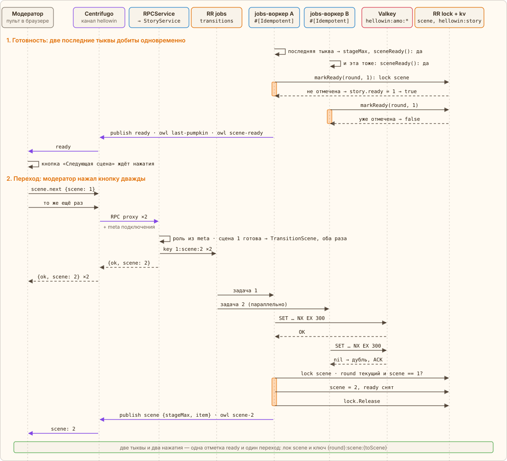

← [Стадии и лок](05-stages.md) · [Оглавление](../../../README.ru.md#как-это-работает) · [Кости](07-dice.md) → | [English](../en/06-idempotency.md)

# Идемпотентный переход

Тыква набрала порог — нужен ровно один переход в следующую стадию. Но клики не останавливаются: пока задача стоит в очереди и ждёт воркер, по тыкве успевают кликнуть ещё n раз, и каждый клик ставит `TransitionPumpkin` снова. Это сделано нарочно. Клику не нужно знать, поставил ли кто-то задачу до него: не нужен ни флаг «переход в пути», ни его сброс, если задача потерялась (очередь в памяти, при рестарте `app` задачи пропадают — следующий клик просто поставит новую). Цена простоты — k + n задач на один переход, и выполниться должна одна.

Отсекает дубли пакет `spiral/idempotency`. Класс задачи помечен атрибутом, и `IdempotencyInterceptor` в цепочке `interceptors.consume` очереди (`app/config/queue.php`) берёт ключ из payload:

[`app/src/Application/Hellowin/Job/TransitionPumpkin.php`](../../../app/src/Application/Hellowin/Job/TransitionPumpkin.php) · `TransitionPumpkin::invoke()`

```php
#[Idempotent(storage: 'transitions', key: 'payload.key')]
final class TransitionPumpkin extends JobHandler
{
    public function invoke(int $round, string $pumpkin, int $toStage, TransitionHandler $transitions, ?string $player = null): void
    {
        $transitions->pumpkin($round, $pumpkin, $toStage, PlayerId::isValid($player) ? $player : null);
    }
}
```

## Кто придумывает ключ

Ключ строит сервер из смысла операции: `TransitionQueue::pumpkinKey()` — `{round}:{pumpkin}:{toStage}`, например `1:pumpkin-3:2` — «в раунде 1 тыква 3 переходит в стадию 2». Все клики, которые ставят этот переход, независимо друг от друга получают один и тот же ключ. Это отличается от привычного Idempotency-Key в стиле Stripe:

|  | Детерминированный ключ (здесь) | Случайный ключ клиента (Stripe-style) |
|---|---|---|
| Кто придумывает | сервер, из данных операции | клиент, UUID на одну попытку действия |
| Где передаётся | в payload задачи, поле `key` | заголовок `Idempotency-Key` запроса |
| Кто дублирует | разные клики разных людей, не знающие друг о друге | тот же клиент при повторе: таймаут, обрыв сети |
| Что защищаем | одно изменение состояния: переход тыквы на стадию | одну попытку запроса: платёж не спишется дважды |
| Два разных намерения с одним ключом | невозможны: тот же ключ — тот же переход | ошибка клиента: сервер сверяет запрос с первым |

Ключ кладётся в payload задачи рядом с данными перехода:

[`app/src/Application/Hellowin/TransitionQueue.php`](../../../app/src/Application/Hellowin/TransitionQueue.php) · `TransitionQueue::pumpkinKey(), ::pumpkin()`

```php
public static function pumpkinKey(int $round, string $pumpkin, int $toStage): string
{
    return \sprintf('%d:%s:%d', $round, $pumpkin, $toStage);
}
// …
public function pumpkin(int $round, string $pumpkin, int $toStage, ?string $player = null, string $type = Element::TYPE_PUMPKIN): void
{
    $this->queue->push(TransitionPumpkin::class, [
        'key' => self::pumpkinKey($round, $pumpkin, $toStage),
        'round' => $round,
        'pumpkin' => $pumpkin,
        'toStage' => $toStage,
        'player' => $player,
    ]);
    $this->metrics->jobPushed($type);
}
```

В Valkey ключ попадает с префиксом хранилища и областью — именем обработчика, чтобы ключи разных задач не столкнулись: `hellowin:amo:App\Application\Hellowin\Job\TransitionPumpkin::handle:1:pumpkin-3:2`.

## Как отсекается дубль

Хранилище `transitions` в `app/config/idempotency.php` — `RedisAtMostOnceConfig` с префиксом `hellowin:amo:` и `retentionTtl: 300`. Перед вызовом обработчика драйвер одной атомарной командой `SET {ключ} M:{token} NX EX 300` занимает ключ. Записал — это первая доставка, обработчик выполняется. Ключ уже был — дубль: обработчик не вызывается вовсе, интерсептор возвращает `null`, и задача подтверждается (ACK) — не падает и не возвращается в очередь. Маркер не удаляется ни при успехе, ни при ошибке и исчезает сам по TTL.

[`app/config/idempotency.php`](../../../app/config/idempotency.php) · `storages.transitions`

```php
'storages' => [
    'transitions' => new RedisAtMostOnceConfig(
        keyPrefix: 'hellowin:amo:',
        retentionTtl: 300,
    ),
    // …
],
```



*Сплошные стрелки — вызовы, пунктир — ответы и ACK. Пунктирная рамка на воркере A — окно между маркером и эффектом.*

## Почему «не более одного раза»

У пакета три гарантии, и они про разное:

| Гарантия | Как устроена | Если воркер упал посреди | Что нужно |
|---|---|---|---|
| `AtLeastOnce` | аренда ключа на время работы; ключ закрывается после эффекта | аренда истекает, повтор выполняет эффект ещё раз — он может случиться дважды | эффект, который безопасно повторить |
| `AtMostOnce` — выбрана | маркер пишется **до** эффекта и не удаляется | эффект потерян, повторы отсекаются, пока жив маркер — 0 или 1 раз | атомарный `SET NX EX` |
| `ExactlyOnce` | запись о задаче и эффект в одной транзакции (inbox) | транзакция откатывается целиком, повтор выполнит эффект заново | эффект и запись в одной БД с транзакциями |

`ExactlyOnce` здесь недостижим: эффект — запись в KV через плагин RoadRunner плюс публикация в Centrifugo, общей транзакции с маркером у них нет. Из оставшихся двух опаснее двойной переход: тыква перепрыгнет стадию, событие `pumpkin` уйдёт дважды. Потерять переход дёшево — тыква останется на пороге, и её дотыкают. Поэтому `AtMostOnce`.

> Цена: если воркер упадёт между маркером и записью стадии (или лок тыквы окажется занят дольше 5 секунд), переход потерян, а новые задачи с тем же ключом отсекаются, пока маркер жив — тыква «застревает» на пороге. Поэтому окно короткое: `retentionTtl` 300 секунд, а не сутки по умолчанию. После него следующий клик снова запускает переход, а от двойного перехода защищает доменная проверка под локом — `stage == toStage − 1`: если переход на самом деле успел выполниться, повтор ничего не меняет.

## <a id="scene-transition"></a>Переход сцены

Сцена не переключается сама: игра идёт не на время, её ведёт модератор. Переход разбит на два шага, и каждый защищён от двойного выполнения по-своему.

1. **Готовность.** После каждого перехода тыквы `TransitionHandler` спрашивает у политики, не дошли ли все тыквы до `stageMax` (`RitualPolicy::sceneReady()`). Последние тыквы могут дойти почти одновременно, и тогда «да» услышат несколько воркеров. Отметку ставит `RitualStore::markReady()` под локом `scene`: в сюжете `hellowin:story` поле `ready` ещё не равно этой сцене — записать и вернуть `true`, уже равно — `false`. Поэтому событие `ready` и реплики совы `last-pumpkin` (с игроком, добившим последнюю тыкву) и `scene-ready` уходят ровно один раз. Сама сцена остаётся прежней.
2. **Готовность с костром.** Со сцены 2 готовых тыкв мало: в центре грядки ещё костёр, один элемент на весь зал. Пока тыквы сцены не готовы, клик по нему отвечает `locked` и никуда не идёт; последняя тыква вместо готовности открывает костёр (отметка в сюжете под тем же локом `scene`, реплика `bonfire-open`). Дальше все бьют в один лок `bonfire` — отсюда ответы `busy` — и после порога костра (лимит `bonfire`) ставят горсть дублей одной задачи `TransitionPumpkin` с ключом `{round}:bonfire:{toStage}`; выполняется одна, это видно по `kind="bonfire"` в метриках. Сцену делает готовой переход костра на его последнюю стадию сцены (`HELLOWIN_BONFIRE_STAGE_MAX`) — тот же `markReady()`, реплики `bonfire-done` и `scene-ready`. Так же в финальной сцене зал рисует магический круг (лок `circle`, ключ `{round}:circle:{toStage}`): замкнутый круг делает финал готовым, и только тогда «Шаг финала» поднимает FrankenPHP (без готовности — лишь с `force`).
3. **Переход.** Модератор нажимает «Следующая сцена» — RPC `scene.next {scene}` с номером сцены, которую он видит. `StoryService::nextScene()` по снимку проверяет: сцена текущая, не финальная и готова (или пришёл `force`) — и ставит `TransitionScene`. Двойной клик, две вкладки пульта или два модератора поставят две задачи, и это то же, что дубли кликов по тыкве: ключ `{round}:scene:{toScene}` (`TransitionQueue::sceneKey()`), тот же `#[Idempotent]` с гарантией `AtMostOnce`, внутри — лок `scene`, проверка `scene == toScene − 1` и одно событие `scene` со `stageMax` новой сцены и предметом фигурок. Нажатие, пришедшее после перехода, видит, что сцена уже не та, и ничего не ставит — просто отвечает текущей.



*Оранжевое — воркер держит лок `scene`. В фазе 1 воркеры выполняют `TransitionPumpkin`, в фазе 2 — `TransitionScene`.*

## Зачем в ключе раунд

После сброса ритуал проходит те же переходы заново: тыква 3 снова идёт в стадию 2. Без раунда ключ совпал бы со старым, и пока жив старый маркер, новый переход отсекался бы как дубль. С раундом это новая операция: `2:pumpkin-3:2`. А задачи прошлого раунда, оставшиеся в очереди, ничего не меняют, даже если пройдут маркер: доменная проверка видит, что раунд уже другой.

## Что видно в Grafana

В разделе «Transitions: queue and idempotency» дашборда — панели «Jobs pushed vs transitions applied» (в минуту и всего, по `kind`), «Duplicates dropped» = `pushed − transitions` и «Pumpkin stages». Чем активнее кликают по тыкве на пороге, тем больше разница. Маркеры можно увидеть и в самом Valkey, вместе с оставшимся TTL:

```shell
docker compose exec valkey valkey-cli --scan --pattern 'hellowin:amo:*'
docker compose exec valkey valkey-cli ttl 'hellowin:amo:App\Application\Hellowin\Job\TransitionPumpkin::handle:1:pumpkin-3:2'
```

---

← [Стадии и лок](05-stages.md) · [Оглавление](../../../README.ru.md#как-это-работает) · [Кости](07-dice.md) → | [English](../en/06-idempotency.md)
