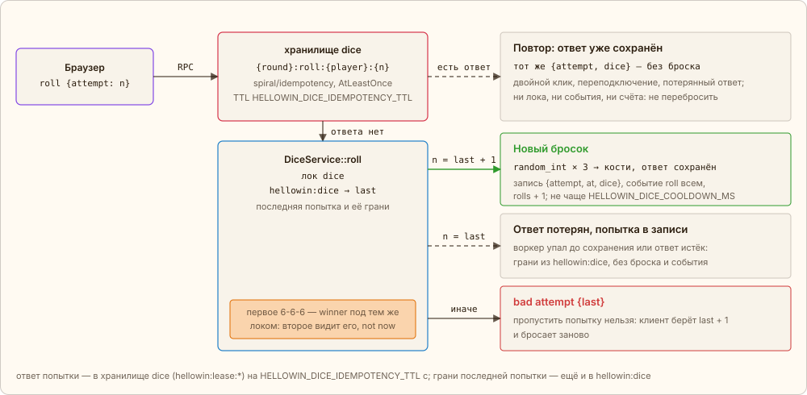

← [Идемпотентный переход](06-idempotency.md) · [Оглавление](../../../README.ru.md#как-это-работает) · [Модератор, фигурки, летуны](08-live.md) → | [English](../en/07-dice.md)

# Кости: идемпотентность с сохранённым ответом

Перед восстанием в финале зал бросает три кости, пока кто-то не выбросит 6-6-6 — версию PHP, которой никогда не было. Бросает сервер: клиент шлёт RPC `roll {attempt}` с номером своей попытки, а в ответ и событием `roll` всем приходят кости. Задача та же, что у перехода тыквы, — повтор запроса не должен дать второй эффект, — но дубль перехода можно просто отбросить, а повтору броска нужен ответ: те же кости. Поэтому ответ попытки *сохраняется*, и повтор получает его.

## Честный бросок

Кости — настоящий случайный выбор: `DiceRoller` трижды берёт `Randomizer::getInt(1, 6)` поверх системного CSPRNG — то же, что `random_int`. Предсказать, на какой попытке выпадет 6-6-6, не может никто, и сервер тоже. Но и посчитать те же кости второй раз нельзя: бросок тянется один раз, а результат нужно запомнить.

## Ключ и сохранённый ответ

Ключ попытки — `{round}:roll:{player}:{attempt}`: раунд, публичный id игрока и номер попытки. `DiceService::roll` выполняет бросок через хранилище `dice` пакета `spiral/idempotency` — лизинг `RedisLeaseConfig` с гарантией **AtLeastOnce**. Первый вызов с ключом бросает и сохраняет ответ `{attempt, dice}` на `HELLOWIN_DICE_IDEMPOTENCY_TTL` с. Повтор того же ключа — двойной клик, переподключение, ретрай после потерянного ответа — получает сохранённый ответ: нового броска нет, события и счёта тоже. Отказ (`busy`, `not now`, `bad attempt`) — не ответ: `FailurePolicy::Release` освобождает ключ, и попытку можно бросить, когда отказ уйдёт.

В коде это один вызов `execute()`; `LockedException` значит, что ту же попытку прямо сейчас бросает другой вызов:

[`app/src/Application/Story/DiceService.php`](../../../app/src/Application/Story/DiceService.php) · `DiceService::roll()`

```php
public function roll(string $id, mixed $attempt): array
{
    // …
    try {
        // A refusal is not an answer: released, so the attempt throws once the refusal is gone
        $answer = $this->replies->execute(
            self::key($round, $id, $attempt),
            $throw,
            new ExecuteOptions(lockTtl: self::LOCK_TTL, ttl: $this->replyTtl, failurePolicy: FailurePolicy::Release),
        );
    } catch (LockedException) {
        throw new StoryRefusedException('busy');
    }
    // …
    return $answer;
}
```

Хранилище `dice` — лизинг рядом с `transitions` в том же конфиге:

[`app/config/idempotency.php`](../../../app/config/idempotency.php) · `storages.dice`

```php
'dice' => new RedisLeaseConfig(
    keyPrefix: 'hellowin:lease:',
    lockTtl: 5,
),
```

Грани последней попытки игрока ещё и лежат в `hellowin:dice` под локом `dice` — одной записью с номером попытки и временем нового броска. Это страховка: AtLeastOnce допускает второй прогон, если воркер упал до сохранения ответа или ответ истёк. Тогда прогон под локом видит свою попытку в записи и отдаёт её грани, не бросая заново.



*Зелёное — новый эффект, пунктир — тот же ответ без эффекта, красное — отказ; оранжевое — работа под локом.*

- **Почему повтор не перебрасывает.** Повтор не бросает: он получает сохранённый ответ, а если тот пропал — грани своей попытки из записи. Новые кости даёт только следующая попытка, и не чаще паузы `HELLOWIN_DICE_COOLDOWN_MS`: перебрать попытки быстрее остальных нельзя. Сравните с переходом тыквы: там AtMostOnce (`hellowin:amo:`) — маркер `SET NX` отсекает дубль, ответ ему не нужен; здесь лизинг AtLeastOnce (`hellowin:lease:`) — дубль получает тот же ответ, что и первый вызов.
- **Первое 6-6-6 — под локом.** Все броски зала проходят через одну запись `hellowin:dice` под одним локом `dice`, как удары по FrankenPHP. Победителя записывает тот, кто взял лок первым; второе 6-6-6 видит его и получает `not now` — как второй выстрел по уже сбитому летуну. Победа делает шаг финала готовым (`markReady`), и сова называет победителя.
- **Сова.** Запасная кнопка модератора `dice.owl`: первые два броска — случайные, а выпавшее 6-6-6 перебрасывается; третий — 6-6-6 наверняка. Ключа идемпотентности нет: каждое нажатие модератора — новый бросок. В число попыток зала (`reveal.rolls`) не идут.

---

← [Идемпотентный переход](06-idempotency.md) · [Оглавление](../../../README.ru.md#как-это-работает) · [Модератор, фигурки, летуны](08-live.md) → | [English](../en/07-dice.md)
