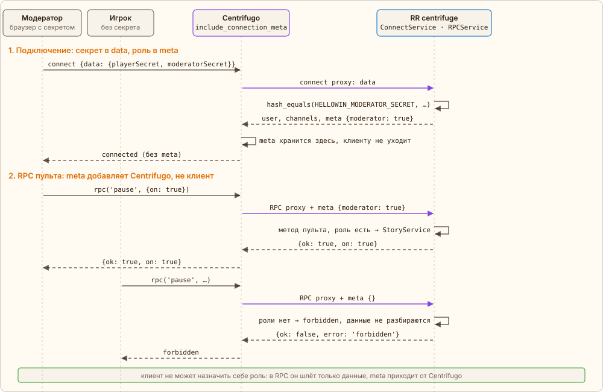
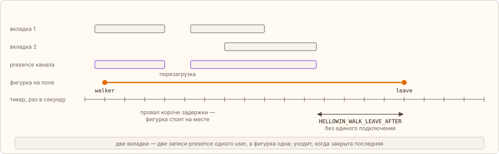
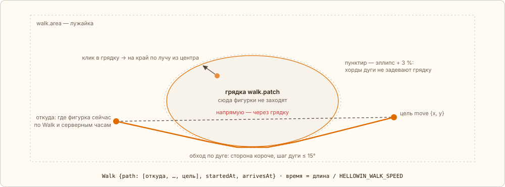
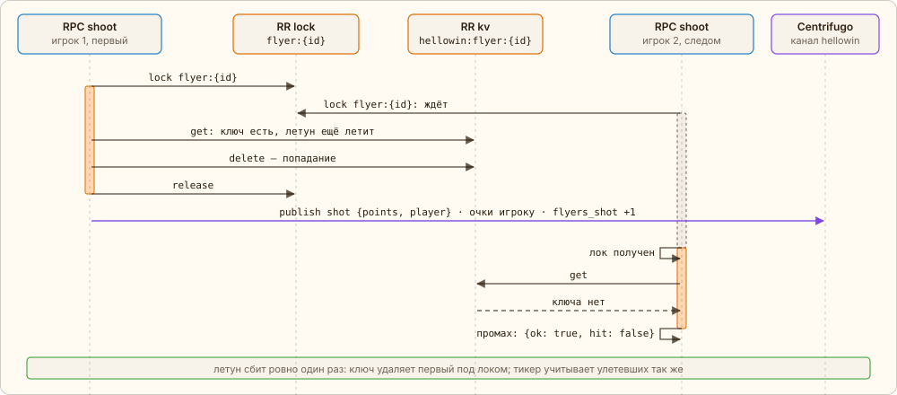

← [Кости](07-dice.md) · [Оглавление](../../../README.ru.md#как-это-работает) · [Метрики](09-metrics.md) → | [English](../en/08-live.md)

# Модератор, фигурки, летуны

Вокруг ритуала — живой вечер: модератор ведёт сюжет с пульта, фигурки игроков ходят по лужайке, по небу летают птицы и нечисть, а в финале сова выкладывает реальные числа. Каждая из этих механик — ещё один приём: роль в meta подключения, presence канала, общие часы сервера, «первый под локом», счёт из состояния без лишних записей.

## <a id="moderator"></a>Роль модератора

Модератор открывает страницу с `?moderator=<секрет>`; страница кладёт секрет в `localStorage`, убирает его из адреса и передаёт в `data` подключения рядом с секретом игрока. `ConnectService` сравнивает его с `HELLOWIN_MODERATOR_SECRET` (`hash_equals`) и при совпадении кладёт `{moderator: true}` в **meta** подключения. Meta хранит Centrifugo, клиенту она не видна, а в каждый RPC proxy Centrifugo добавляет её сам — так настроено `rpc.proxy.include_connection_meta` в `config.json`. Клиент шлёт в RPC только данные и не может назначить себе роль запросом. Пустой секрет в env — роли нет ни у кого.

`RPCService` читает роль из meta и на методы пульта (`scene.next`, `finale.step`, `owl.say`, `flyer.special`, `flyers.burst`, `pause`, `thresholds`, `reset`) без неё отвечает `forbidden` ещё до разбора данных. `thresholds {k}` умножает все лимиты на `k` ([«Лимиты»](05-stages.md#limits)) — подогнать ритуал под зал на ходу; `k` лежит в сюжете и переживает сброс. `pause {on}` — пауза прогресса: задача сцены замирает, а зал живёт дальше. RPC, которые двигают задачу (`click` по тыквам, костру и кругу, `drink`, `strike`, `roll`), не отказывают: действие проходит, событие уходит всем, но с `counted: false` — клики и стадии стоят, кружки не идут в цель, здоровье босса прежнее, 6-6-6 не выигрывает, готовность сцены не наступает. Игроки паузу не видят — она только на пульте; летунов, зомби и выстрелы пауза не трогает. Снятая пауза догоняет своё тем же пересчётом, что и снизившийся лимит, а сброс снимает её сам. Роль — не в `user`: модератор может быть и игроком со своим секретом, а `user` — это публичный id игрока в событиях и presence. Каждый метод пульта безопасно повторить: `StoryService` меняет сюжет `hellowin:story` под локом `scene`, сравнивает «до» и «после» и публикует событие (и реплику совы) только при изменении.



*Сплошные стрелки — запросы, пунктир — ответы. Фиолетовые — вызовы proxy из Centrifugo.*

## <a id="walkers"></a>Фигурки на поле: presence и тикер

Игрок, собравший персонажа на экране входа (RPC `register` с именем и `look`), — фигурка на лужайке. Кто сейчас на странице, сервер не считает сам: у канала `hellowin` включён presence Centrifugo (`"presence": true` в `config.json`, клиентам он закрыт). Каждое подключение подписано на канал сервером, поэтому presence — это все открытые вкладки с `user` = публичный id игрока, и запись пропадает сама, как только соединение закрылось.

Раз в секунду тикер (`WalkService::sync()`) спрашивает presence через gRPC API Centrifugo (`CentrifugoPresence`), сводит записи к набору игроков и под локом `walkers` сравнивает его с ключом `hellowin:walkers`: у присутствующих обновляет `seenAt`, игроки с `look` без фигурки выходят на поле (событие `walker`), а фигурки, чьих игроков нет дольше `HELLOWIN_WALK_LEAVE_AFTER` мс, уходят (`leave`). Несколько вкладок — несколько записей одного `user`, но фигурка одна и уходит, когда закрыта последняя. Задержка ухода нужна, чтобы перезагрузка страницы не роняла фигурку и не переносила её к краю.



*Прямоугольники — открытые соединения и записи presence, оранжевая линия — фигурка на поле, засечки — тики. Длины условные: задержка — `HELLOWIN_WALK_LEAVE_AFTER`.*

Почему не connect proxy: в момент connect клиент ещё не подписан на канал и своё событие `walker` не получил бы. Почему не refresh proxy с продлением подключений: уход был бы виден только по истечении срока, а каждое продление — лишний вызов и запись в KV. Presence — готовый учёт подключений, который Centrifugo сам чистит при разрыве. Сбой опроса presence пишется в лог, а фигурки остаются: недоступный presence не значит, что все ушли.

## <a id="walk-path"></a>Путь фигурки считает сервер

Клик по земле — только намерение: RPC `move {x, y}`. Координаты кадр за кадром никто не шлёт. `WalkService::move()` приводит цель в зону — прямоугольник лужайки `walk.area` минус эллипс грядки `walk.patch` из `app/config/hellowin.php` (клик в грядку — на её край), берёт начало там, где фигурка сейчас по её текущему пути и серверным часам, и строит ломаную: напрямую, если отрезок не задевает грядку, иначе по касательной к эллипсу, увеличенному на 3 %, по его дуге и по касательной к цели, — со стороны, где путь короче. Длительность — длина ломаной, делённая на `HELLOWIN_WALK_SPEED`. Под локом `walkers` путь записывается в `hellowin:walkers`, а в канал уходит событие `move` с `Walk {path, startedAt, arrivesAt}`.

Событие собирает `ChannelPublisher::move()`, а все события канала уходят одним `publish()` — через `BroadcastInterface` и плагин `centrifuge` в gRPC API Centrifugo:

[`app/src/Application/Hellowin/ChannelPublisher.php`](../../../app/src/Application/Hellowin/ChannelPublisher.php) · `ChannelPublisher::move(), ::publish()`

```php
public function move(int $round, Walker $walker, ?string $stop = null): void
{
    $message = [
        'type' => 'move',
        'round' => $round,
        'player' => ['id' => $walker->id],
        'walk' => $walker->walk->toArray(),
    ];
    // …

    $this->publish($message);
}

private function publish(array $message): void
{
    $this->broadcast->publish(
        $this->channel,
        \json_encode($message, \JSON_THROW_ON_ERROR | \JSON_UNESCAPED_UNICODE),
    );
}
```



*Оранжевая ломаная — путь из события `move`; его одинаково анимируют все клиенты.*

> Анимацию задаёт сервер, а не клиент кликнувшего. Каждый браузер по `now` из снимка знает смещение своих часов от серверных и ставит фигурку в точку пути, где она должна быть в этот момент серверного времени. Поэтому все видят одно и то же движение, а вкладка, открытая посреди хода, сразу рисует фигурку на середине пути. Новый `move` во время хода начинается из текущей точки.

Чоканье по клику в проклятом мире — тот же путь плюс отложенная проверка: RPC `clink` ведёт фигурку к цели и кладёт рядом с ней в `hellowin:walkers` запись «жду встречи к `dueAt`», а тикер каждые 200 мс под локом `walkers` снимает наступившие записи и, если цель не ушла, публикует ровно одно событие `clink` с тостом и временем встречи.

## <a id="flyers"></a>Летуны и зомби: очки — первому

Летунов запускает тикер: случайно раз в `HELLOWIN_FLYER_INTERVAL` мс, вид — из набора текущей сцены `HELLOWIN_FLYER_KINDS`, изредка редкий (`HELLOWIN_FLYER_RARE`), ещё модератор может выпустить особого кнопкой или целую волну («Пуск летунов», [«Лимиты»](05-stages.md#limits)). Траекторию сервер присылает готовой: событие `flyer` с точками, глубиной, очками и временем `launchedAt` / `expiresAt`, а в KV — ключ `hellowin:flyer:{id}` с TTL и индекс летящих. Зомби проклятого мира — те же летуны (`kind: zombie`, свой интервал `HELLOWIN_ZOMBIE_INTERVAL`), только идут по лужайке от края грядки наружу, — поэтому выстрел, очки и метрики у них общие. Пауза прогресса тикер не останавливает: летуны и зомби идут, попадание засчитывается игроку, только подбитый на паузе зомби не идёт в цель проклятого мира.

Клик по летуну — RPC `shoot {flyer}`. Под локом `flyer:{id}`: ключ ещё есть, по летуну можно стрелять и полёт не кончился — ключ удаляется, это попадание: очки игроку, одно событие `shot`, метрика. Следующий выстрел ключа уже не найдёт — промах. Каждый тик тикер тем же способом учитывает улетевших: ключ ещё есть — удалить и засчитать как улетевшего. Ключ удаляет ровно один из них, поэтому летун не бывает и сбит, и улетел. Сервер принимает выстрел до `expiresAt` + 500 мс, а клиент не рисует летуна, чьё время по серверным часам уже вышло.

Очки собираются в топ стрелков вечера — `hellowin:top` под локом `top` (`TopService`). Попадание пишет туда не «+N», а абсолютные очки игрока, которые вернула его запись, и берёт `max(старое, новое)`: повтор и гонка дважды не посчитают. Сам выстрел ничего не публикует — доску шлёт тикер событием `top {board}`, когда она изменилась, и не чаще `HELLOWIN_TOP_INTERVAL` мс. Это склейка: при полном зале полный список каждому на каждое попадание — слишком много, а раз в интервал — один. Доска живёт весь вечер, сброс её не чистит, и она же лежит в снимке страницы.



*Оранжевое — воркер держит лок, пунктирная рамка — ждёт его.*

## <a id="reveal"></a>Разоблачение: числа вечера

На шаге финала, где сова раскрывает правду, событие `finale` и снимок несут `reveal` — реальные числа раунда. Отдельных счётчиков на каждый клик для этого нет: всё следует из состояния в Valkey, которое и так пишется под локами. `RevealBuilder` считает их заново при каждой сборке.

| Число | Откуда | Почему так |
|---|---|---|
| `clicks` — обработанные клики | Σ `accepted` по `hellowin:pumpkin:{id}` | `accepted` растёт под тем же локом, что и `clicks`, но не обнуляется при переходе |
| `jobs` — задачи, прошедшие очередь | Σ `stage` + `scene` | каждая стадия и каждая сцена — ровно одна выполненная задача перехода |
| `burned` — сгоревшие клики | `clicks` − Σ `spent` − Σ min(`clicks` тыквы, порог) | переход тратит ровно порог, действовавший при его выполнении, и прибавляет его к `spent` тыквы; остальное отбросила идемпотентность или пришло после готовности тыквы, кроме кликов, ещё копящихся к переходу |
| `shot` — сбитые летуны и зомби | `hellowin:shot` — `{round, count}` под локом `shot` | единственный отдельный счётчик: выстрелы редки, лок не мешает; счёт другого раунда читается как 0 |
| `drinks`, `slain`, `damage` — кружки вечера, зомби и удары по FrankenPHP | `hellowin:drinks`, `hellowin:cursed`, `hellowin:boss` — каждый с `round` | счётчики бара, проклятого мира и босса уже есть ради игры; запись другого раунда читается как пустая |
| `lastPumpkin` — кто добил последнюю тыкву | `lastPumpkin` в `hellowin:story` | игрок из задачи, которая отметила готовность сцены; `null`, если клик был анонимным или сцену переключили `force` |

Сброс раунда обнуляет эти числа без отдельного кода: `accepted`, `stage`, `scene` и сюжет сбрасываются вместе с ритуалом, а счёт сбитых привязан к раунду.

---

← [Кости](07-dice.md) · [Оглавление](../../../README.ru.md#как-это-работает) · [Метрики](09-metrics.md) → | [English](../en/08-live.md)
