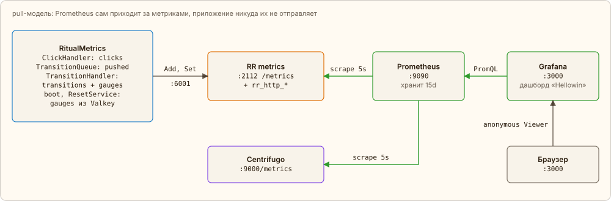

← [Модератор, фигурки, летуны](08-live.md) · [Оглавление](../../../README.ru.md#как-это-работает) | [English](../en/09-metrics.md)

# Метрики

При старте воркера `HellowinBootloader` объявляет коллекторы в плагине `metrics` и выставляет gauge из состояния в Valkey — оно переживает перезапуск RoadRunner. Дальше `RitualMetrics` вызывает `metrics.Add` и `metrics.Set` по RPC из клика, постановки задачи, перехода и сброса, а `PlayMetrics` — из выстрела и тикера (летуны, фигурки, игроки). Ошибка метрик только пишется в лог: клик из-за неё не падает. RoadRunner отдаёт всё на `:2112/metrics` вместе со своими `rr_http_*` (middleware `http_metrics` в `.rr.yaml`; там же `gzip`, который сжимает и ответы PHP, и статику — он стоит перед `static`, потому что RoadRunner 3 выполняет middleware слева направо).

Как это выглядит в коде — на RPC-метриках с вкладки [«Клик»](04-click.md): коллекторы объявляются один раз, значения пишутся по ходу работы:

[`app/src/Application/Hellowin/PlayMetrics.php`](../../../app/src/Application/Hellowin/PlayMetrics.php) · `PlayMetrics::declare(), ::rpc()`

```php
public function declare(): void
{
    $collectors = [
        // …
        self::RPC_CALLS => Collector::counter()->withHelp('RPC calls by method and result: ok or the error code.')->withLabels('method', 'result'),
        self::RPC_DURATION => Collector::histogram(...self::RPC_BUCKETS)->withHelp('RPC handling time in PHP, seconds.')->withLabels('method'),
        // …
    ];

    foreach ($collectors as $name => $collector) {
        $this->safely(fn() => $this->metrics->declare($name, $collector));
    }
}

public function rpc(string $method, string $result, float $seconds): void
{
    $this->safely(fn() => $this->metrics->add(self::RPC_CALLS, 1, [$method, $result]));
    $this->safely(fn() => $this->metrics->observe(self::RPC_DURATION, $seconds, [$method]));
}
```

Prometheus раз в 5 секунд скрейпит `app:2112` и `centrifugo:9000/metrics` (внутренний порт Centrifugo: наружу открыт только WebSocket на 8000). Grafana получает datasource и дашборд «Hellowin» через provisioning и пускает анонимно в роли Viewer: смотреть может любой, редактировать — нет.



*Стрелки показывают, кто инициирует запрос; данные по scrape-стрелкам идут обратно.*

| Метрика | Откуда | Что значит |
|---|---|---|
| `hellowin_clicks_total{type, element}` | ClickHandler | counter: принятые клики |
| `hellowin_transition_jobs_pushed_total{kind}` | TransitionQueue | counter: задачи перехода в очереди, дубли включительно; `kind` — `pumpkin` или `scene` |
| `hellowin_transitions_total{kind}` | TransitionHandler | counter: реально выполненные переходы |
| `hellowin_scene_stage` | TransitionHandler, старт, сброс | gauge: текущая сцена |
| `hellowin_round` | старт, сброс | gauge: текущий раунд |
| `hellowin_pumpkin_stage{element}` | TransitionHandler, старт, сброс | gauge: стадия каждой тыквы |
| `hellowin_flyers_launched_total{depth}`, `hellowin_flyers_shot_total{depth}`, `hellowin_flyers_escaped_total{depth}` | тикер, RPC `shoot` | counter: запущенные, сбитые и улетевшие несбитыми летуны (и зомби) |
| `hellowin_walkers` | тикер, раз в секунду | gauge: фигурки на поле |
| `hellowin_players`, `hellowin_players_registered` | тикер, счёт игроков `PlayerCensus` | gauge: известные игроки и игроки с именем |
| `hellowin_online_players`, `hellowin_online_connections` | тикер `WalkService`, presence канала Centrifugo | gauge: кто онлайн сейчас — уникальные игроки и все подключения, с анонимами; то же число видит модератор на пульте |
| `hellowin_rpc_calls_total{method, result}` | RPCService | counter: каждый RPC через вебсокет; `method` — имя метода или `unknown`, `result` — `ok` или код ошибки |
| `hellowin_rpc_duration_seconds{method}` | RPCService | histogram: сколько PHP обрабатывал RPC |
| `hellowin_rpc_rate_limited_total{group}` | RPCService | counter: вызовы, отклонённые лимитом (`rate limited`), по группе ведра |
| `hellowin_beer_mugs_total{place}` | BarService | counter: выпитые кружки; `place` — `bar` или `cursed` (проклятый мир) |
| `hellowin_beer_litres` | тикер, счёт игроков `PlayerCensus` | gauge: выпито за вечер, литров — кружки игроков × `HELLOWIN_MUG_LITRES` |
| `rr_http_request_total`, `rr_http_request_duration_seconds`, `rr_http_workers_*` | RoadRunner http | HTTP-запросы, задержка, воркеры |
| `centrifugo_node_num_clients`, `centrifugo_transport_messages_sent`, `centrifugo_proxy_duration_seconds_histogram` | Centrifugo | подключения, отправленные сообщения, задержка proxy-вызовов в RoadRunner |

Счётчики живут в процессе RoadRunner и обнуляются при его перезапуске, gauge восстанавливаются из Valkey. Разделы дашборда: **Game** — клики, сцена, раунд, онлайн; **Transitions: queue and idempotency** — задачи против выполненных переходов, отсечённые дубли, стадии тыкв; **Centrifugo** — соединения, сообщения, proxy-вызовы; **RoadRunner** — HTTP и воркеры.

Запросы с дашборда, например:

```promql
# клики в секунду, всего и по тыквам
sum(rate(hellowin_clicks_total[1m]))
sum by (element) (rate(hellowin_clicks_total[1m]))

# отсечённые дубли: задачи в очереди минус выполненные переходы
sum by (kind) (hellowin_transition_jobs_pushed_total) - sum by (kind) (hellowin_transitions_total)

# p95 задержки proxy-вызовов Centrifugo → RoadRunner
histogram_quantile(0.95, sum by (le, type) (rate(centrifugo_proxy_duration_seconds_histogram_bucket[1m])))
```

[Открыть дашборд в Grafana](http://localhost:3000/) · [Вернуться к тыквам](http://localhost:8080/)

---

← [Модератор, фигурки, летуны](08-live.md) · [Оглавление](../../../README.ru.md#как-это-работает) | [English](../en/09-metrics.md)
